<div align="right">
  🌐 <strong>Idioma / Language:</strong> <a href="./README.md">🇺🇸 Read in English</a> | 🇦🇷 <strong>Español</strong>
</div>

# Zero-Cost Automated Quoting Engine — End-to-End Service Design & DesignOps Case Study


> **De documentos de Word improvisados, errores manuales de suma y reseñas de 1★ en Google Maps a un motor automatizado que emite presupuestos corporativos en PDF y los envía por WhatsApp en menos de 45 segundos.**  
> Diseño de servicio *end-to-end*, arquitectura de información y automatización *low-code/code-hybrid* para escalar la operación comercial de **Lubricantes Sur** (Salta, Argentina) con **$0 de presupuesto en infraestructura**.

---

## 📊 TL;DR — Impacto Operativo y de Negocio (Executive Summary)

En un lubricentro de alta rotación presencial con 5 a 6 empleados por turno, emitir un presupuesto implicaba abrir un archivo de Word suelto, tipear productos de memoria, sumar con calculadora y enviar el archivo por WhatsApp sin ningún estándar visual ni registro contable.

| Indicador / Dimensión Operativa | Antes (Proceso Manual en Word) | Después (Sistema Automatizado) | Impacto de Negocio y UX |
| :--- | :--- | :--- | :--- |
| **Tiempo de emisión y envío** | ~15 – 30 min *(en huecos libres)* | **< 45 segundos** *(punta a punta)* | **-95% tiempo operativo en mostrador** |
| **Errores de suma y tipeo de precios** | Frecuentes *(cálculo manual apurado)* | **0%** *(cálculo matricial en `AUX`)* | **Eliminación de pérdidas y reclamos en caja** |
| **Protección ante inflación / vigencia** | Nula *(a menudo olvidaban poner fecha)* | **100% normado** *(Fecha + Validez `15 días`)* | **Fin de disputas por precios desactualizados** |
| **Trazabilidad por empleado y cliente** | **0%** *(archivos anónimos sueltos)* | **100% auditable** *(Operador, ID `P-YYYY-NNN`, Total)* | **Accountability interno y base para BI** |
| **Experiencia en el "Último Eslabón" (WhatsApp)** | Errática *(sin saludo o en MAYÚSCULAS)* | **Mensaje cálido pre-redactado en 1 clic** | **Protección de la reputación digital (Google Reviews)** |
| **Costo mensual de licencias / SaaS** | $0 | **$0 USD / mes** | **100% ROI sin costos fijos para el negocio** |

---

## 🔍 1. Reframing the Brief: De "Hacer una Plantilla" a Rediseñar el Servicio

### El Pedido Inicial vs. El Problema Real
La gerencia operativa del negocio se acercó con un pedido clásico de diseño gráfico:
> *"¿Nos podés hacer una plantilla más linda para que a los chicos les resulte más fácil armar los presupuestos?"*

Al auditar los presupuestos históricos que entregaban (archivos como `PRESUPUEST0 MUUNI (1).docx`, escrito con un cero en el título y totales tipeados con espacios como `TOTAL:$3 66 .000`) y observar la dinámica *in-situ* del local, detecté que **una plantilla gráfica no iba a resolver el problema**: mientras los empleados tuvieran que seguir llenando celdas manualmente y sumando precios a las apuradas entre cliente y cliente, los errores iban a continuar.

### El Disparador Crítico: Cómo la Fricción Operativa Destruía la Reputación Digital
Como responsable de la estrategia de comunicación digital y redes sociales de la marca, detecté que las fallas en el proceso de presupuestación impactaban directamente en el último eslabón de contacto con el cliente, generando **reseñas negativas de 1 estrella en Google Maps**:

> ★☆☆☆☆ **Caso real registrado en Google Business Profile:**  
> *"Un día fui por un presupuesto y me pasaron 108 mil con cambio de todos los filtros y aceite, le pedí turno para el otro día y cuando fui al otro día me quisieron cobrar 140 mil, se enojaron y me cobraron los 108 y no me cambiaron el filtro de nafta (ni me avisaron que no lo cambiaron)."*

### Los 7 Dolores Sistémicos Detectados en la Investigación In-Situ
1. **Riesgo inflacionario por falta de validez:** En una economía de alta inflación, olvidar la fecha o el plazo de validez permitía que un cliente volviera meses después reclamando un precio viejo. El dueño debía elegir entre **absorber la pérdida económica** o **generar la sospecha de sobreprecio**.
2. **Errores de cálculo bajo presión:** Con el local lleno de clientes presenciales, los empleados sumaban mal los ítems o detallaban productos de forma ambigua, provocando discusiones al momento de pagar.
3. **Ausencia de trazabilidad interna (*Accountability*):** Nadie sabía cuál de los 5 o 6 empleados había emitido un presupuesto con errores. El dueño terminaba llamando la atención a todo el equipo sin poder identificar ni corregir el desvío puntual.
4. **Ceguera comercial:** No existía registro histórico de cuánto dinero se presupuestaba por mes ni qué volumen aportaban los clientes recurrentes.
5. **Caos documental y de nomenclatura:** Archivos guardados sin criterio (`PRESUPUEST0.docx`), con tipografías y logos distintos según quién atendiera el turno.
6. **Aspereza en la entrega por WhatsApp:** Por falta de tiempo, el archivo se enviaba "en crudo", sin saludo o con textos cortantes en mayúsculas, enfriando la intención de compra de presupuestos que técnicamente estaban bien cotizados.
7. **Falta de segmentación entre Cliente Particular y Flotas:** Se intentaba resolver con el mismo documento plano tanto el servicio de un vehículo particular como la cotización de flotas corporativas o municipales.

---

## ⚖️ 2. Decisión Estratégica de Producto (Trade-off Analysis)

La restricción de negocio era clara: **el sistema debía soportar +100 presupuestos mensuales a costo $0 USD/mes para el dueño**, ser utilizable desde el celular o la PC del mostrador, y ejecutarse en menos de 1 minuto.

| Alternativa Evaluada | Complejidad | Escalabilidad ($0) | Fidelidad Editorial PDF | Control de UX / Datos | Decisión Estratégica |
| :--- | :---: | :---: | :---: | :---: | :--- |
| **A. Jotform + Sheets + Document Studio / AutoCrat** | 🟢 Baja | 🔴 Límites de cuota gratuita | 🟢 Alta | 🟡 Parcial | ❌ **Superada:** Se prototipó inicialmente, pero los límites mensuales de los add-ons gratuitos y la falta de una pantalla interactiva de envío a WhatsApp motivaron el desarrollo de un motor propio. |
| **B. Fillout + Airtable / Notion + Make** | 🟡 Media | 🔴 Requiere plan pago al escalar | 🟡 Media | 🟢 Excelente | ❌ **Descartada:** Generaba dependencia de suscripciones en dólares para automatizar la creación de PDFs. |
| **C. Glide App / Softr (No-Code App)** | 🟡 Media | 🔴 Límites por usuario/filas | 🟢 Alta | 🟢 Excelente | ❌ **Descartada:** Excelente experiencia móvil, pero con costos recurrentes innecesarios para la etapa actual del negocio. |
| **D. Custom Web App (React + DB)** | 🔴 Alta | 🟡 Costos de mantenimiento | 🟢 Total | 🟢 Total | ❌ **Sobre-ingeniería:** Reservada únicamente para una fase futura de +500 presupuestos/mes. |
| **✅ E. Arquitectura Híbrida Propia (HTML Hub + Jotform CSS + Sheets `AUX` + Apps Script + Slides)** | 🟡 Media | 🟢 **Ilimitada ($0/mes)** | 🟢 **Editorial (InDesign → Slides)** | 🟢 **Total** | ✅ **Implementada:** Cero costo de licencias, UI unificada de punta a punta y control total del código y los datos. |

---

## 🏗️ 3. Arquitectura del Servicio (End-to-End Service Blueprint)

El sistema fue diseñado para que el empleado sienta que interactúa con **una única aplicación cohesiva**, ocultando en el *Backstage* la orquestación entre 5 servicios gratuitos.

```mermaid
flowchart LR
    subgraph Entry ["1️⃣ Frontstage: Hub Inicial"]
        H["🌐 Landing HTML/CSS<br/>(1 Vehículo vs. Flota)"]
    end

    subgraph Capture ["2️⃣ Frontstage: Captura Guiada"]
        J["📝 Jotform Custom CSS<br/>(4 Bloques + Poka-Yoke)"]
    end

    subgraph Engine ["3️⃣ Backstage: Normalización y Motor"]
        S1[("📥 Hoja 1: Presupuestos<br/>(Raw Input Inmutable)")]
        S2[("⚙️ Hoja 2: AUX<br/>(Regex + Cálculo Total)")]
        GAS{"🚀 Apps Script (main.gs)<br/>Trigger & Orquestador"}
        SL["🎨 Google Slides<br/>(Plantilla con Tokens)"]
        DR[("📁 Google Drive<br/>/Cliente/Mes/PDF")]
    end

    subgraph Handoff ["4️⃣ Frontstage: Smart Handoff"]
        W["📱 WebApp Post-Envío<br/>(Polling Asíncrono 4s)"]
        WA(["💬 WhatsApp (wa.me)<br/>Mensaje Cálido + Link PDF"])
    end

    H -->|Selecciona flujo| J
    J -->|Webhook nativo| S1
    J -->|Redirige con ?xid={id}| W
    S1 -->|ARRAYFORMULA| S2
    S2 -->|Estado = 'Listo'| GAS
    GAS -->|Clona e inyecta {{tokens}} + QR| SL
    SL -->|Exporta PDF inmutable| DR
    DR -->|Escribe pdf_url y wa_url| S2
    W <-->|google.script.run.pollData(xid)| S2
    W -->|1-Click Handoff| WA
```

👉 *Ver desglose detallado en [`docs/01-service-blueprint.es.md`](./docs/01-service-blueprint.es.md).*

---

## 🎨 4. Decisiones Clave de UX, UI e Ingeniería (Poka-Yoke)

### 1. Unificación Visual Cross-Platform (Coherencia Percibida)
Para evitar que los empleados sintieran que saltaban entre plataformas desconectadas, se descartaron constructores genéricos como *Carrd* y se diseñó un **Design System ligero** basado en los colores institucionales de Lubricantes Sur (`#FFD500`, `#D70613`, `#000000`), tipografías `Antonio` + `Fira Sans` y tarjetas *Glassmorphism*.
* **Inyección de CSS Avanzado en Jotform ([`src/styles/jotform-custom.css`](./src/styles/jotform-custom.css)):** Se eliminó por completo la apariencia nativa de Jotform. Se implementaron estados de foco de alto contraste pensados para el uso rápido en mostrador o celular: **halo amarillo al pasar el cursor (`:hover`)** y **borde rojo intenso al enfocar el campo activo (`:focus`)**.

| 1. Hub Inicial | 2. Operador | 3. Datos Cliente | 4. Marca Auto |
| :---: | :---: | :---: | :---: |
| 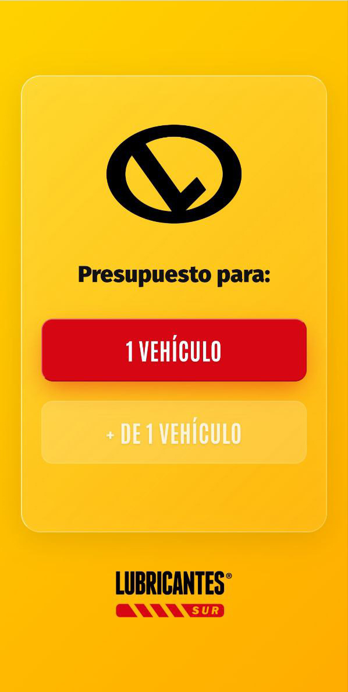 | 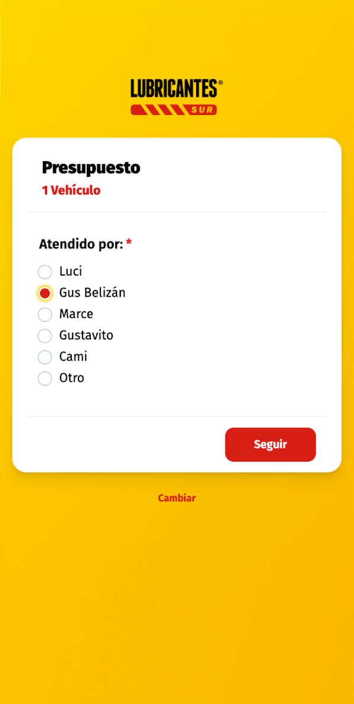 | 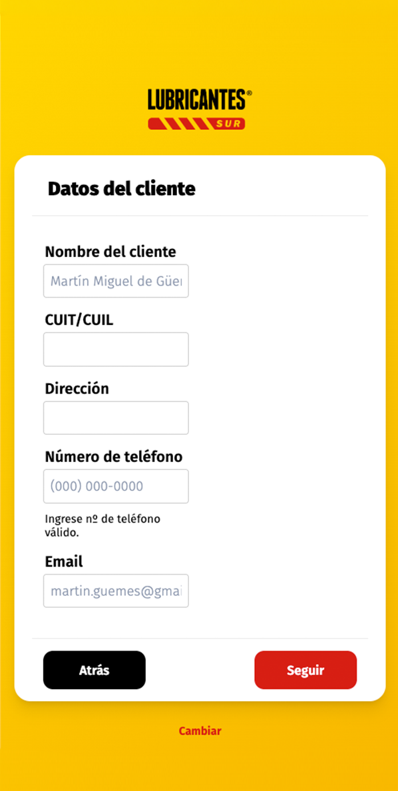 | 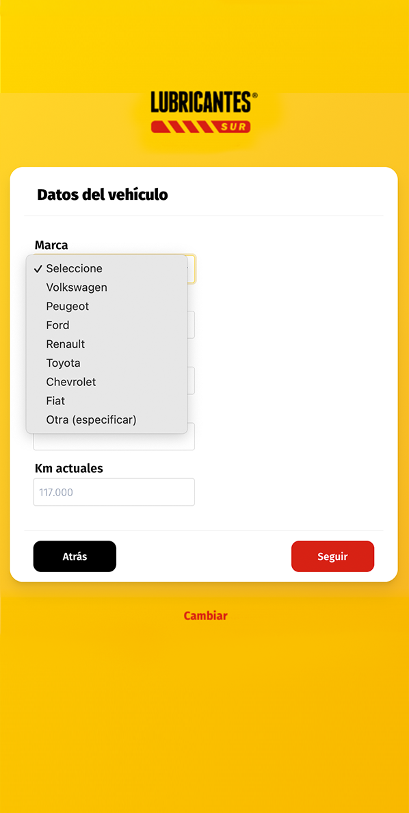 |

---

### 2. Reducción de Carga Cognitiva y Eliminación del Cálculo Mental
A partir de la auditoría de los presupuestos antiguos, la información se estructuró en **4 bloques mentales secuenciales**:
1. **Identificación y Cliente:** Selección en 1 toque del vendedor (`Atendido por: *`) para asegurar trazabilidad, seguido de datos del cliente con máscaras de validación en teléfono y CUIT/CUIL.
2. **Datos del Vehículo con Escape Condicional:** Desplegable con las marcas más frecuentes para evitar tipear en el móvil, más la opción `"Otra (especificar)"` que despliega dinámicamente un campo adicional. En el *Backstage*, la hoja `AUX` unifica esas 3 columnas en un único token limpio (`vehiculo_marca`).
3. **Matriz de Servicio "Cero Calculadora":** El empleado **solo ingresa `Cantidad`, `Descripción` e `Importe Unitario`**. Nunca multiplica ni suma.
4. **Observaciones Acotadas y Comentario Interno Silencioso:** Se limitaron los campos de `Observación del cliente` y `Diagnóstico técnico` a **`188 caracteres`** para impedir que textos extensos rompan la maquetación del PDF, y se añadió un campo de **`Comentario interno`** exclusivo para la base de datos que jamás se imprime en el documento del cliente.

| 5. Datos del Vehículo | 6. Matriz de Ítems (Sin sumas) | 7. Diagnóstico (188 chars) y Validez |
| :---: | :---: | :---: |
| 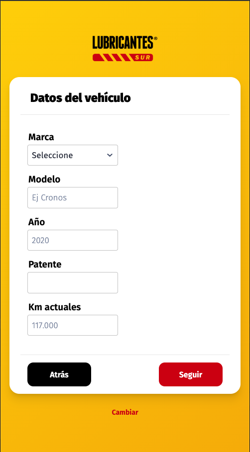 | 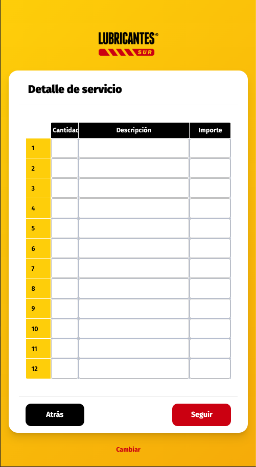 | 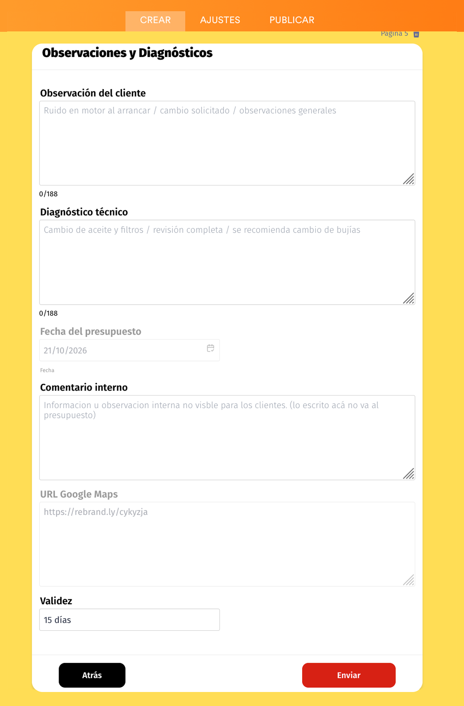 |

---

### 3. Ingeniería "Poka-Yoke" en Google Sheets (`AUX`) y Apps Script (`main.gs`)
El personal de mostrador escribe rápido y bajo presión. En lugar de exigirles formatear textos, el sistema corrige y normaliza automáticamente cada entrada antes de inyectarla en el PDF:

* **Detección Inteligente de Granel (`L`) vs. Envasado (`un.`):** En el lubricentro se vende tanto aceite suelto por litro como filtros o envases cerrados. Los empleados escribían indistintamente `4`, `4L`, `4 lts`, `4 litros` o incluso con errores de tipeo como `4 litos`. La función [`enrichMap_`](./src/main.gs#L251-L260) en `main.gs` evalúa cada cantidad mediante Regex:
  ```javascript
  const regexLitros = /\s*(?:litros?|litos?|ltrs?|lts?|lt?)\.?$/i;
  if (regexLitros.test(s)) { s = s.replace(regexLitros, ' L'); }
  else { if (!isNaN(parseFloat(s))) s = s + ' un.'; }
  ```
* **Cálculo Matricial Automático (`Cantidad × Unitario = Subtotal`):** La pestaña `AUX` extrae la cifra numérica pura de la cantidad (incluso si el empleado escribió `"4 litros"`), la multiplica por el precio unitario y suma los 12 ítems en la columna `TOTAL`.
* **Saneamiento de Patentes y Nombres Propios:** Fórmulas en `AUX` convierten `"juan perez"` o `"JUAN PEREZ"` en `"Juan Perez"` (`PROPER(LOWER(TRIM(...)))`) y limpian patentes como `"ab-773 kz"` a `"AB773KZ"`.

| Pestaña 1: `Presupuestos` (Raw Input de Jotform) | Pestaña 2: `AUX` (Datos Normalizados + Estado + Links) |
| :---: | :---: |
| 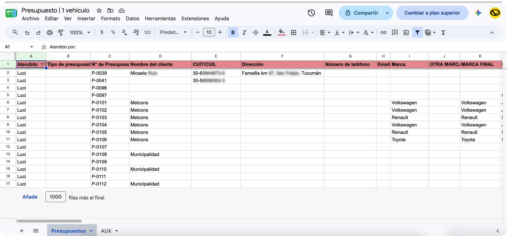 | 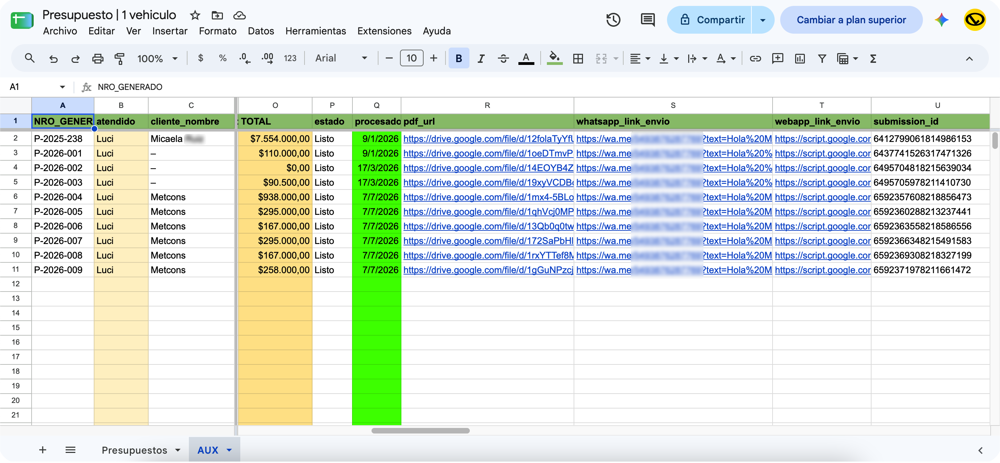 |

👉 *Ver todas las fórmulas reales en [`templates/sheets-schema.es.md`](./templates/sheets-schema.es.md).*

---

### 4. Del Diseño Editorial en Adobe InDesign a Design Tokens en Google Slides
Para erradicar la informalidad visual de los antiguos archivos de Word y transmitir **seriedad comercial**, la plantilla del presupuesto fue diseñada primero en **Adobe InDesign** (optimizando la legibilidad tabular, el peso de los totales y el bloque legal/institucional) y luego recreada en **Google Slides** mediante marcadores dinámicos (`{{token}}`).
* **Inyección de QR Dinámico ([`insertQr_`](./src/main.gs#L181-L203)):** El script reemplaza el marcador `{{QR_MAPS}}` en el pie del documento por un código QR de alta resolución generado al vuelo con las coordenadas exactas del contenedor.

| Plantilla Maestra con Design Tokens (`Google Slides`) | Presupuesto Final Renderizado y Normalizado (`PDF`) |
| :---: | :---: |
| 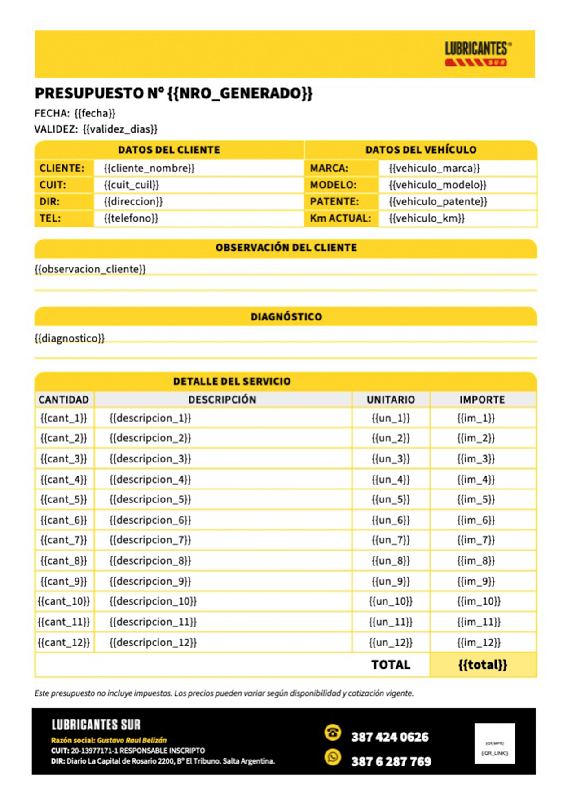 | 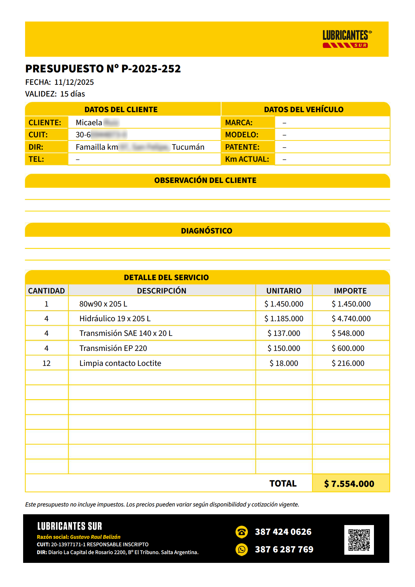 |

👉 *Ver referencia completa de tokens en [`templates/slides-tokens-reference.es.md`](./templates/slides-tokens-reference.es.md).*

---

### 5. Cerrando el "Último Eslabón": WebApp Asíncrona con Polling y WhatsApp en 1 Clic
Una vez que el empleado presiona **Enviar** en Jotform, en lugar de mostrar una página estática de agradecimiento que lo obligue a entrar a Google Drive a buscar el PDF, es redirigido a una **WebApp propia en Google Apps Script** (`?xid={submission_id}`):

1. **Feedback de Espera en Tiempo Real (Client-Side Polling):** Mientras el motor en segundo plano clona el Slide y exporta el PDF, [`src/postenvio.html`](./src/postenvio.html) muestra un estado activo (`.procesando` en color rojo) y consulta cada 4 segundos a [`pollData(xid)`](./src/webapp.gs#L62-L88) mediante `google.script.run`.
2. **Self-Healing UI & Desbloqueo Instantáneo:** En cuanto el PDF está listo en Drive, la tarjeta transiciona suavemente al estado `.listo`, actualiza el saludo con el nombre del vendedor (`¡Hola, Luci!`) y habilita los botones de acción.
3. **Estandarización del Tono en WhatsApp:** El botón **Enviar a WhatsApp** abre `https://wa.me/549...` con el teléfono del cliente ya normalizado al formato internacional argentino y el mensaje pre-redactado:
   > *"Hola Micaela R., te envío tu presupuesto P-2025-252: [Link directo al PDF]"*

<p align="center">
  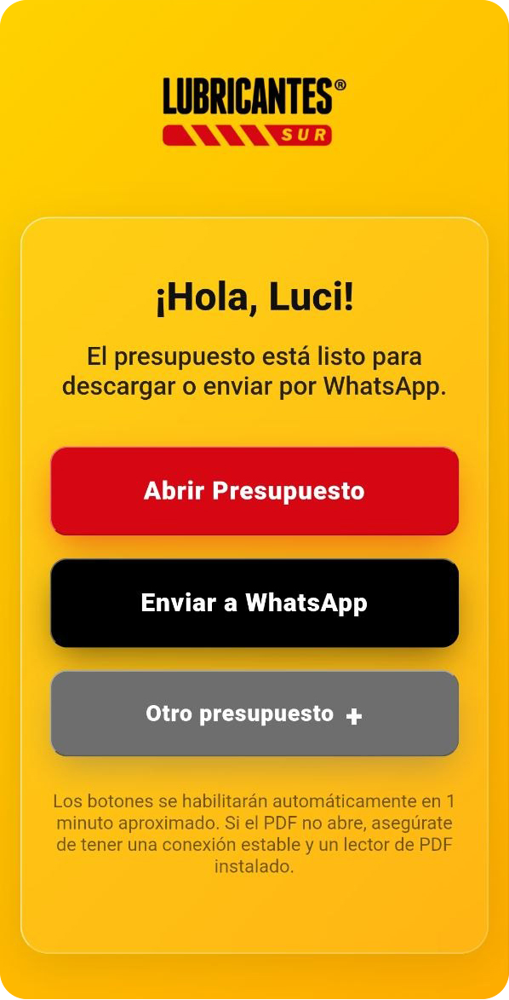
</p>

---

## 🚀 6. Aprendizajes, Resultados y Roadmap (Fases 2 y 3)

### Impacto Observado Post-Lanzamiento
* **Adopción inmediata del equipo:** Al unificar visualmente todas las pantallas y eliminar la necesidad de usar calculadora o redactar mensajes de WhatsApp, los empleados adoptaron la herramienta desde el primer día tanto en la PC del mostrador como desde sus propios teléfonos móviles.
* **Erradicación de conflictos por precios vencidos:** La inclusión automática de fecha y validez (`15 días`) eliminó las discusiones en mostrador por desfasajes inflacionarios.
* **Visibilidad total para la dirección:** El dueño pasó de no tener registro de los presupuestos emitidos a contar con una base de datos ordenada cronológicamente con responsable, cliente, vehículo, monto total y copia exacta del PDF en Google Drive.

### Roadmap Proyectado (Escalabilidad del Producto)
1. **Fase 2 — Módulo Modular para Flotas (`+ de 1 Vehículo`):** El Hub inicial ([`src/landing/index.html`](./src/landing/index.html)) ya dejó preparada la bifurcación hacia un segundo flujo diseñado específicamente para empresas y municipios, con bloques repetibles por dominio/patente y consolidación automática de subtotales por unidad.
2. **Fase 3 — Dashboard Ejecutivo en Power BI / Looker Studio:** Con la pestaña `AUX` operando como base de datos estructurada, la tercera etapa proyectada consiste en conectar un tablero visual para que la gerencia monitoree métricas mensuales (volumen total presupuestado, ticket promedio, ranking de emisión por empleado y recurrencia de clientes) sin necesidad de abrir la hoja de cálculo.

---

<p align="center">
  Diseñado y desarrollado por <strong>Emiliano Parra</strong> · Senior Product Designer & DesignOps Builder
</p>
