<div align="right">
  🌐 <strong>Language / Idioma:</strong> 🇺🇸 <strong>English</strong> | <a href="./README.es.md">🇦🇷 Leer en Español</a>
</div>

# ⚡ Zero-Cost Automated Quoting Engine — End-to-End Service Design & DesignOps Case Study


> **From ad-hoc Word documents, manual math errors, and 1★ Google Reviews to an automated engine that generates print-ready corporate PDF quotes and dispatches them via WhatsApp in under 45 seconds.**  
> End-to-end Service Design, Information Architecture, and *low-code/code-hybrid* automation built to scale commercial quoting operations for **Lubricantes Sur** (Salta, Argentina) with a **$0/month infrastructure budget**.

---

## 📊 TL;DR — Business & Operational Impact (Executive Summary)

In a high-foot-traffic automotive service center (*lubricentro*) with 5 to 6 rotating staff members per shift, issuing a quote previously meant opening a loose Word file, typing items from memory, adding totals on a calculator, and sending raw files over WhatsApp with zero visual consistency or financial tracking.

| Operational / Business Metric | Before (Manual Word Flow) | After (Automated Quoting Engine) | Business & UX Impact |
| :--- | :--- | :--- | :--- |
| **Quote generation & delivery time** | ~15 – 30 min *(during spare moments)* | **< 45 seconds** *(end-to-end)* | **-95% shop-floor operational friction** |
| **Pricing & addition error rate** | Frequent *(rushed manual math)* | **0%** *(centralized matrix logic in `AUX`)* | **Eliminated revenue leakage & checkout disputes** |
| **Inflation & validity protection** | None *(dates frequently omitted)* | **100% enforced** *(Auto-Date + `15-day` validity)* | **Eliminated expired-price conflicts** |
| **Staff & revenue traceability** | **0%** *(anonymous local files)* | **100% auditable** *(Operator, ID `P-YYYY-NNN`, Total)* | **Full internal accountability & BI readiness** |
| **Last-mile customer handoff (WhatsApp)** | Erratic *(no greeting or ALL-CAPS)* | **1-click warm, pre-filled message** | **Protected brand equity & Google Reviews** |
| **Monthly SaaS / Infrastructure cost** | $0 | **$0 USD / month** | **100% immediate ROI with zero fixed fees** |

---

## 🔍 1. Reframing the Brief: From "Making a Pretty Template" to Designing a System

### The Initial Request vs. The Underlying Systemic Problem
Operations management originally approached me with a classic graphic design request:
> *"Can you design a nicer template so the staff can put together quotes more easily?"*

After auditing historical quotes (such as `PRESUPUEST0 MUUNI (1).docx`—literally spelled with a zero in the filename and manual spaces inside numbers like `TOTAL:$3 66 .000`) and observing shop-floor operations *in-situ*, I realized **a static visual template would fail**: as long as 5–6 busy employees had to manually type prices and calculate totals between walk-in customers, human error would persist.

### The Critical Trigger: How Internal Friction Destroyed Digital Reputation
Because I also managed the company's digital channels and social media strategy, I connected a dot that internal operations had missed: quoting errors at the counter were directly translating into **1-star public reviews on Google Maps**, undoing months of brand-building:

> ★☆☆☆☆ **Real Google Business Profile Review:**  
> *"One day I went in for a quote and they told me 108k for changing all filters and oil. I booked an appointment for the next day, and when I showed up they tried to charge me 140k, got angry, charged me 108k, and didn't change the fuel filter (without even telling me)."*

### 7 Systemic Pain Points Uncovered During In-Situ Research
1. **Inflationary exposure from missing validity dates:** In Argentina's high-inflation economy, quotes issued without dates or expiration terms meant customers returned months later demanding outdated prices. The owner either **absorbed the financial loss** or **faced customer backlash and accusations of price gouging**.
2. **Manual math errors under pressure:** With high walk-in rotation, staff assembled quotes in a rush, miscalculating totals or omitting items.
3. **Zero internal accountability:** Because multiple employees shared the counter PC, nobody knew who had created a flawed quote. The owner had to reprimand the entire team instead of coaching the specific employee.
4. **Commercial blindness:** Zero historical tracking of monthly quoted volume, conversion rates, or recurring fleet accounts.
5. **File naming chaos:** Quotes were saved locally with arbitrary names (`PRESUPUEST0.docx`), inconsistent logos, and varying fonts.
6. **Rough "Last-Mile" delivery on WhatsApp:** Pressed for time, employees sent raw files with no greeting or curt ALL-CAPS messages, cooling down purchase intent even when pricing was competitive.
7. **Lack of customer segmentation (Retail vs. Fleet):** Single-vehicle retail customers and multi-vehicle corporate/municipal fleets were handled with the exact same improvised document.

---

## ⚖️ 2. Strategic Product Decision (Trade-off Analysis)

The business constraint was non-negotiable: **the solution had to scale past 100+ quotes/month at $0 USD/month for the owner**, work seamlessly on both mobile phones and the counter PC, and execute in under 1 minute.

| Evaluated Architecture | Complexity | $0 Scalability | PDF Editorial Quality | UX & Data Control | Strategic Verdict |
| :--- | :---: | :---: | :---: | :---: | :--- |
| **A. Jotform + Sheets + Document Studio / AutoCrat** | 🟢 Low | 🔴 Capped by free-tier quotas | 🟢 High | 🟡 Partial | ❌ **Outgrown:** Prototyped initially, but monthly add-on limits and the inability to customize the post-submit WhatsApp handoff screen led to building a native Apps Script engine. |
| **B. Fillout + Airtable / Notion + Make** | 🟡 Medium | 🔴 Requires paid tiers at scale | 🟡 Medium | 🟢 High | ❌ **Discarded:** Introduced recurring USD subscription costs for PDF automation webhooks. |
| **C. Glide App / Softr (No-Code App)** | 🟡 Medium | 🔴 User & row limits on free plan | 🟢 High | 🟢 High | ❌ **Discarded:** Great mobile UI, but introduced unnecessary monthly licensing fees. |
| **D. Custom Web App (React + DB)** | 🔴 High | 🟡 Hosting & maintenance overhead | 🟢 Full | 🟢 Full | ❌ **Over-engineered:** Reserved only for a future scenario of 500+ quotes/month. |
| **✅ E. Custom Hybrid Engine (HTML Hub + Jotform CSS + Sheets `AUX` + Apps Script + Slides)** | 🟡 Medium | 🟢 **Unlimited ($0/mo)** | 🟢 **Print-grade (InDesign → Slides)** | 🟢 **Full** | ✅ **Shipped:** Zero licensing cost, unified cross-platform UI, and full ownership of logic and data. |

---

## 🏗️ 3. Service Architecture (End-to-End Service Blueprint)

The system was engineered so that shop-floor staff experience **a single, cohesive application**, while the *Backstage* silently orchestrates 5 free services in real time.

```mermaid
flowchart LR
    subgraph Entry ["1️⃣ Frontstage: Entry Hub"]
        H["🌐 HTML/CSS Landing Hub<br/>(1 Vehicle vs. Fleet)"]
    end

    subgraph Capture ["2️⃣ Frontstage: Guided Capture"]
        J["📝 Jotform + Custom CSS<br/>(4 Cognitive Blocks + Poka-Yoke)"]
    end

    subgraph Engine ["3️⃣ Backstage: Normalization & Engine"]
        S1[("📥 Tab 1: Presupuestos<br/>(Immutable Raw Input)")]
        S2[("⚙️ Tab 2: AUX<br/>(Regex + Auto-Math)")]
        GAS{"🚀 Apps Script (main.gs)<br/>Trigger & Orchestrator"}
        SL["🎨 Google Slides<br/>(Tokenized Master Template)"]
        DR[("📁 Google Drive<br/>/Client/Month/PDF")]
    end

    subgraph Handoff ["4️⃣ Frontstage: Smart Handoff"]
        W["📱 Post-Submit WebApp<br/>(4s Async JS Polling)"]
        WA(["💬 WhatsApp (wa.me)<br/>Warm Pre-filled Msg + PDF"])
    end

    H -->|Routes flow| J
    J -->|Native webhook| S1
    J -->|Redirects with ?xid={id}| W
    S1 -->|ARRAYFORMULA| S2
    S2 -->|State = 'Listo'| GAS
    GAS -->|Clones & injects {{tokens}} + QR| SL
    SL -->|Exports immutable PDF| DR
    DR -->|Writes pdf_url & wa_url| S2
    W <-->|google.script.run.pollData(xid)| S2
    W -->|1-Click Handoff| WA
```

👉 *Read the full technical sequence in [`docs/01-service-blueprint.md`](./docs/01-service-blueprint.md).*

---

## 🎨 4. Key UX, UI & "Poka-Yoke" Engineering Decisions

### 1. Cross-Platform Visual Unification (Perceived Cohesion)
To prevent employees from feeling like they were jumping across disconnected tools, I discarded third-party page builders (*Carrd*) and coded a lightweight **Design System** using Lubricantes Sur's brand tokens (`#FFD500`, `#D70613`, `#000000`), `Antonio` + `Fira Sans` typography, and *Glassmorphism* cards.
* **Advanced CSS Injection in Jotform ([`src/styles/jotform-custom.css`](./src/styles/jotform-custom.css)):** Completely stripped Jotform's default styling and implemented high-contrast tactile states tailored for fast mobile/counter input: **yellow glow on `:hover`** and **bold red border/halo on active `:focus`**.

| 1. Entry Hub | 2. Operator | 3. Client Data | 4. Brand Select |
| :---: | :---: | :---: | :---: |
| 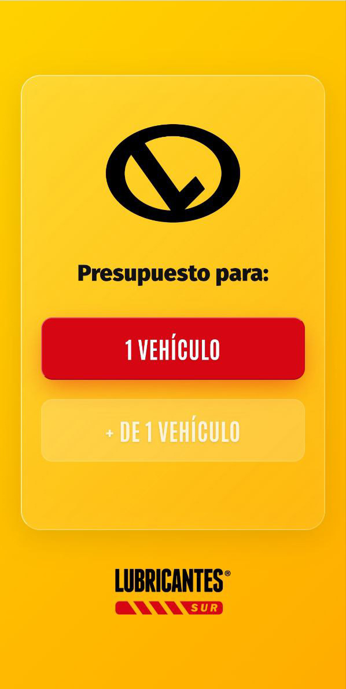 | 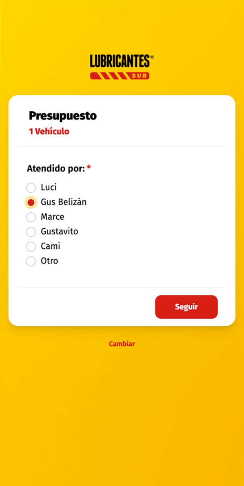 | 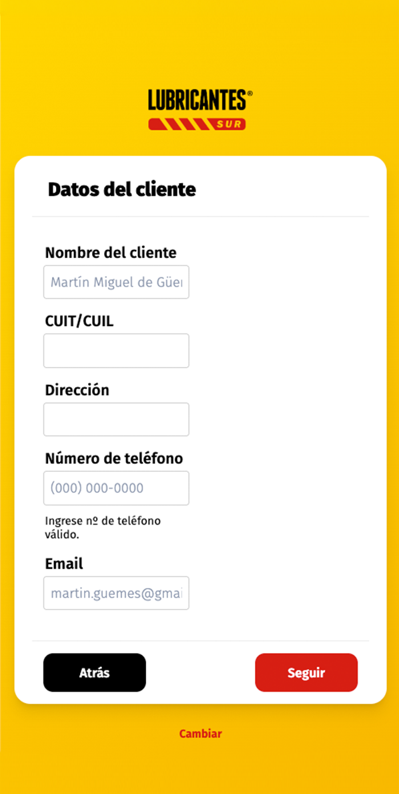 | 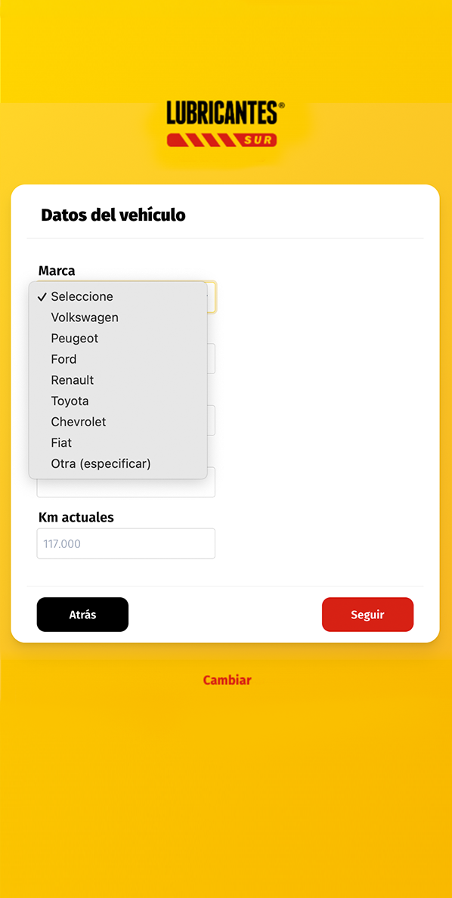 |

---

### 2. Cognitive Load Reduction & Zero Mental Math
Based on the audit of legacy quotes, data capture was reorganized into **4 sequential cognitive blocks**:
1. **Operator & Customer Info:** 1-tap operator selection (`Atendido por: *`) ensuring internal accountability, followed by validated customer inputs (phone and tax ID masks).
2. **Vehicle Data with Conditional Escape:** A dropdown featuring the most common local car brands to avoid mobile typing, plus an `"Otra (especificar)"` option that conditionally reveals a text input. In the *Backstage*, the `AUX` sheet silently collapses those 3 columns into a single clean attribute (`vehiculo_marca`).
3. **"Zero-Calculator" Service Matrix:** Staff **only input `Quantity`, `Description`, and `Unit Price`**. They never multiply or add totals.
4. **Character-Capped Diagnostics & Silent Internal Notes:** Customer observations and technical diagnostics are strictly capped at **`188 characters`** to prevent text overflow in the PDF layout. A dedicated **`Comentario interno`** field allows staff to log internal shop notes that are saved in the database but never printed on the customer's PDF.

| 5. Vehicle Details | 6. Service Matrix (Zero math) | 7. Diagnostics (188 chars) & Validity |
| :---: | :---: | :---: |
| 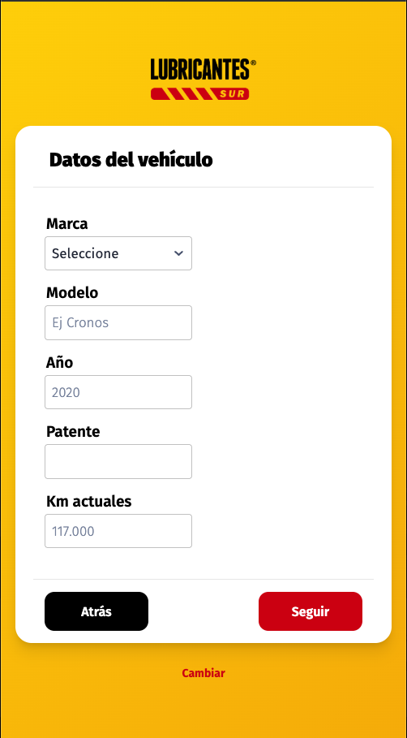 | 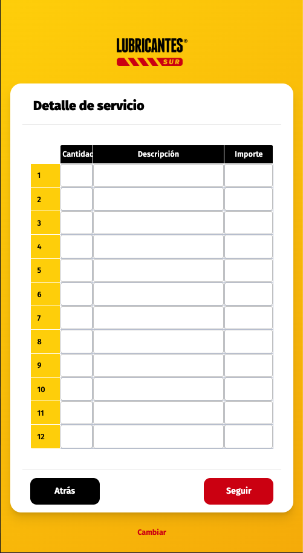 | 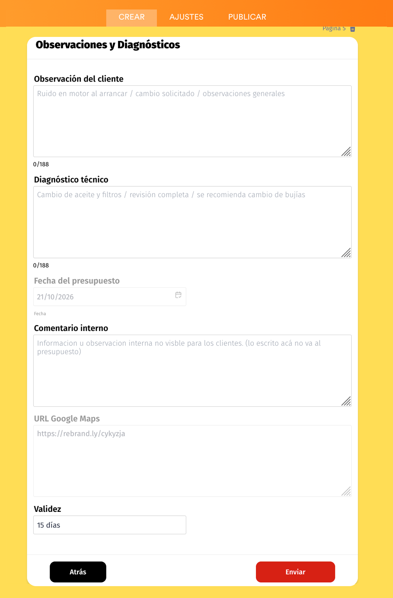 |

---

### 3. "Poka-Yoke" Data Normalization in Google Sheets (`AUX`) & Apps Script (`main.gs`)
Shop-floor employees type fast under pressure. Instead of forcing strict input rules that slow them down, the backend automatically sanitizes and normalizes every entry before rendering the PDF:

* **Smart Bulk (`L`) vs. Packaged (`un.`) Unit Recognition:** A service center sells both bulk oil by the liter and sealed filters/containers. Staff typed `4`, `4L`, `4 lts`, `4 litros`, or even common typos like `4 litos`. The [`enrichMap_`](./src/main.gs#L251-L260) function in `main.gs` inspects each quantity via Regex:
  ```javascript
  const regexLitros = /\s*(?:litros?|litos?|ltrs?|lts?|lt?)\.?$/i;
  if (regexLitros.test(s)) { s = s.replace(regexLitros, ' L'); }
  else { if (!isNaN(parseFloat(s))) s = s + ' un.'; }
  ```
* **Automated Matrix Multiplication (`Quantity × Unit Price = Subtotal`):** The `AUX` tab extracts the raw numeric value from the quantity string (even if the user typed `"4 litros"`), multiplies it by the unit price, and sums all 12 rows into `TOTAL`.
* **License Plate & Proper Name Sanitization:** Formulas in `AUX` convert `"juan perez"` or `"JUAN PEREZ"` into `"Juan Perez"` (`PROPER(LOWER(TRIM(...)))`) and normalize license plates like `"ab-773 kz"` into `"AB773KZ"`.

| Tab 1: `Presupuestos` (Immutable Raw Jotform Input) | Tab 2: `AUX` (Normalized Data + State + Generated Links) |
| :---: | :---: |
| 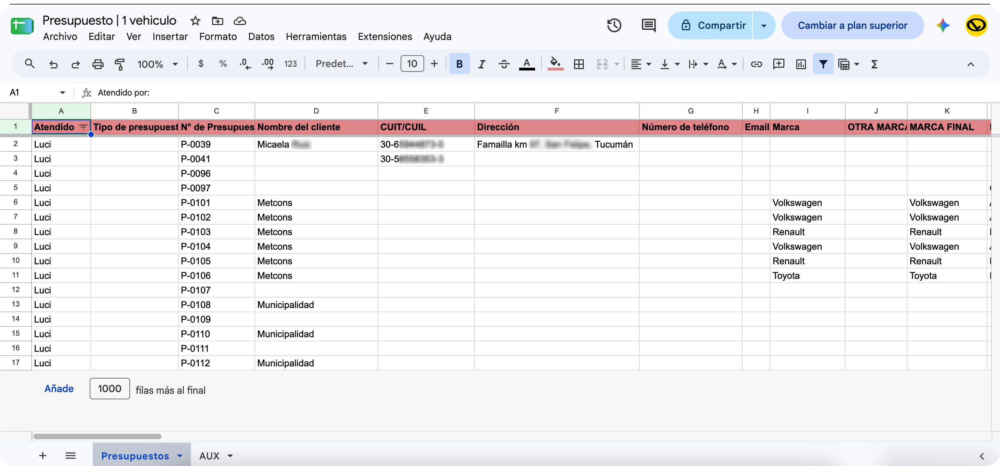 | 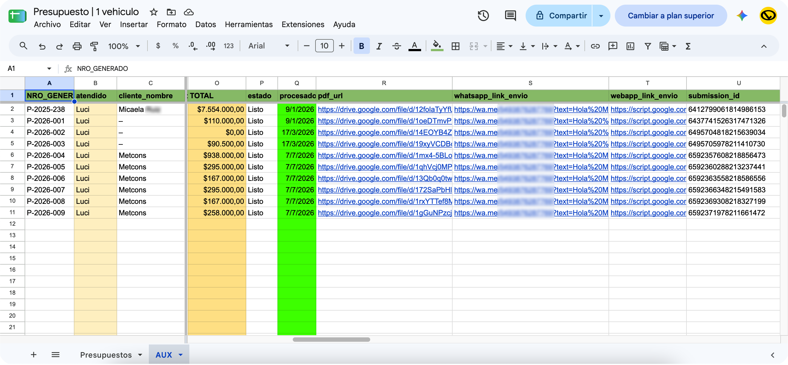 |

👉 *Explore all production formulas in [`templates/sheets-schema.md`](./templates/sheets-schema.md).*

---

### 4. Editorial Design System: From Adobe InDesign to Google Slides Tokens
To replace informal Word files with a document that conveys **commercial authority and trust**, the quote layout was first designed in **Adobe InDesign** (optimizing tabular hierarchy, cost readability, and legal/brand footers) and then rebuilt inside **Google Slides** using dynamic content tokens (`{{token}}`).
* **Dynamic QR Injection ([`insertQr_`](./src/main.gs#L181-L203)):** The script locates the `{{QR_MAPS}}` placeholder shape in the footer and replaces it on the fly with a high-resolution QR code linked to the shop's location.

| Tokenized Master Template (`Google Slides`) | Final Normalized & Rendered Output (`PDF`) |
| :---: | :---: |
| 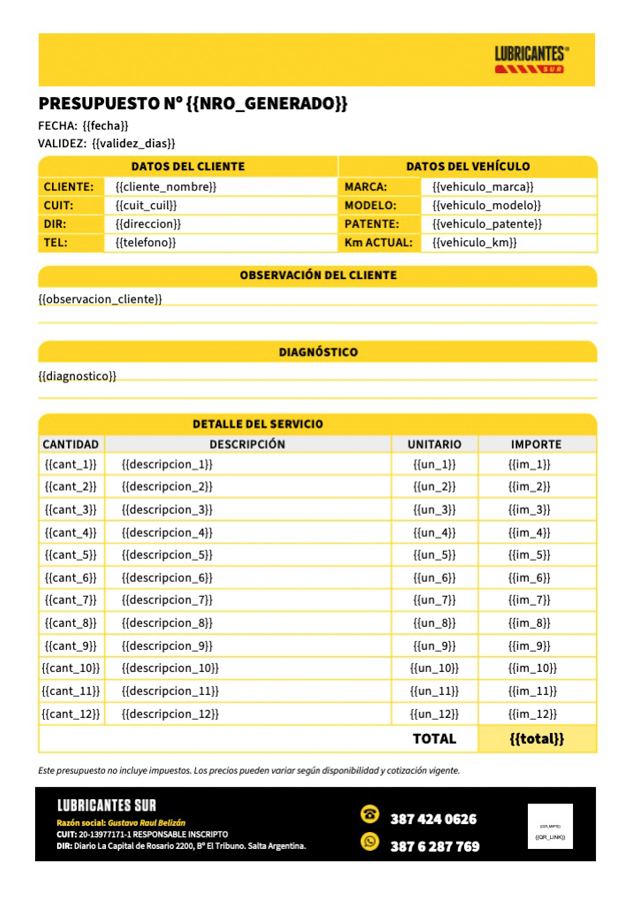 | 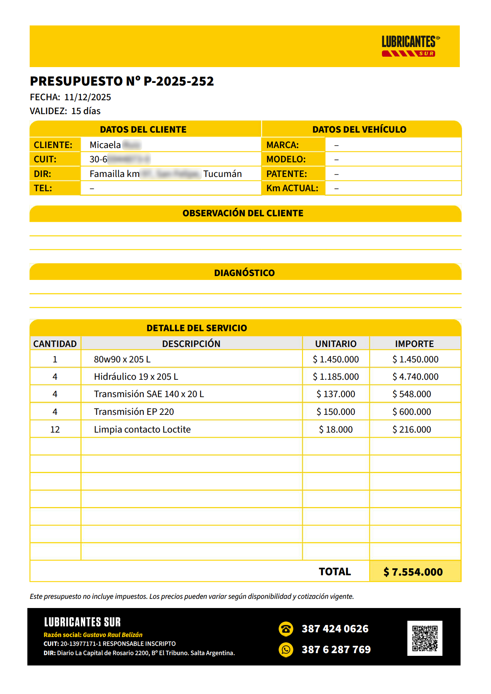 |

👉 *See the full token dictionary in [`templates/slides-tokens-reference.md`](./templates/slides-tokens-reference.md).*

---

### 5. Closing the "Last Mile": Async Polling WebApp & 1-Click Empathetic WhatsApp
When an employee hits **Submit** in Jotform, instead of hitting a dead-end "Thank You" page and having to hunt for the PDF inside Google Drive, they are redirected to a custom **Google Apps Script WebApp** (`?xid={submission_id}`):

1. **Real-Time Waiting Feedback (Client-Side Polling):** While the backend clones the Slide template and exports the PDF, [`src/postenvio.html`](./src/postenvio.html) displays a high-visibility red `.procesando` state and polls [`pollData(xid)`](./src/webapp.gs#L62-L88) every 4 seconds via `google.script.run`.
2. **Self-Healing UI & Instant Unlock:** As soon as the PDF URL is written to `AUX`, the card smoothly transitions to the `.listo` state, updates the header with the operator's name (`¡Hola, Luci!`), and unlocks the action buttons.
3. **Standardized Customer Tone on WhatsApp:** Clicking **Enviar a WhatsApp** launches `https://wa.me/549...` with the customer's phone number automatically formatted to international Argentine standards and a warm, pre-written message:
   > *"Hola Micaela R., te envío tu presupuesto P-2025-252: [Direct PDF Link]"*

<p align="center">
  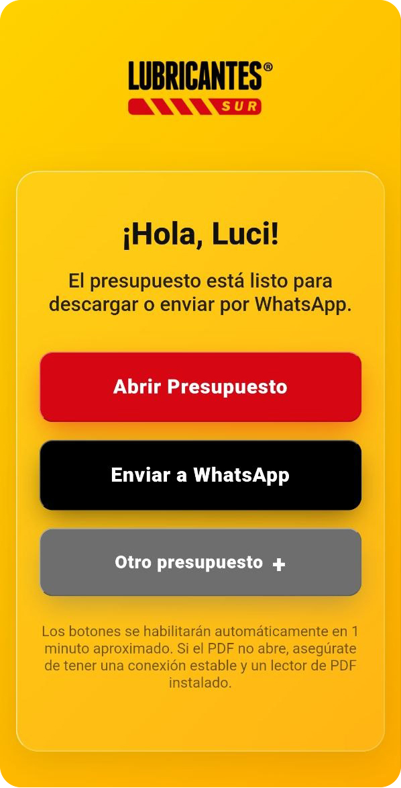
</p>

---

## 📂 5. Repository Architecture

```text
├── README.md                          # Primary Case Study (English)
├── README.es.md                       # Primary Case Study (Spanish)
├── LICENSE                            # MIT License
│
├── assets/                            # Sanitized production screenshots & visual evidence
│   ├── 01-landing-hub.jpg             # Initial segmentation hub (1 Vehicle vs. Fleet)
│   ├── 02-operator-selection.png      # Operator attribution (Internal accountability)
│   ├── 03-client-data.png             # Block 1: Validated customer details
│   ├── 04-vehicle-brand-dropdown.png  # Block 2: Quick car brand selector
│   ├── 04-vehicle-data.png            # Block 2: Model, year, license plate & mileage
│   ├── 05-service-items-matrix.png    # Block 3: Service matrix (Qty, Description, Unit Price)
│   ├── 05b-observations-and-diagnostics.png # Block 4: Diagnostics (188 chars), internal note & validity
│   ├── 06-webapp-handoff-ready.png    # Post-submit WebApp with PDF & WhatsApp actions
│   ├── 07-sheets-raw-inputs.png       # Tab 1 (Presupuestos): Raw Jotform inputs (PII blurred)
│   ├── 08-sheets-normalized-aux.png   # Tab 2 (AUX): Normalization engine & links (PII blurred)
│   ├── 09-slides-master-template.jpeg # Tokenized master template in Google Slides
│   └── 10-final-pdf-output.png        # Final auto-generated PDF quote (PII blurred)
│
├── docs/                              # Deep-dive Product & Service Design documentation
│   ├── 01-service-blueprint.md        # Sequence diagram & Frontstage/Backstage mapping (EN / ES)
│   ├── 02-ux-decisions-and-tradeoffs.md # In-situ research, 7 pain points & trade-off matrix (EN / ES)
│   └── 03-setup-guide.md              # Step-by-step replication guide ($0 stack) (EN / ES)
│
├── src/                               # Sanitized production source code
│   ├── main.gs                        # Core engine: Sheets AUX -> Slides -> PDF -> Drive -> WA Link
│   ├── webapp.gs                      # WebApp backend (doGet + pollData with Self-Healing Name)
│   ├── postenvio.html                 # Post-submit UI with Glassmorphism & 4s async polling
│   ├── appsscript.json                # Google Apps Script V8 manifest & OAuth scopes
│   ├── landing/
│   │   └── index.html                 # Static Entry Hub hosted on Netlify / GitHub Pages
│   └── styles/
│       └── jotform-custom.css         # Custom CSS injected into Jotform for Mobile-First White-Labeling
│
└── templates/                         # Database schemas & Design Token references
    ├── sheets-schema.md               # Real ARRAYFORMULA & Regex formulas from the AUX sheet (EN / ES)
    └── slides-tokens-reference.md     # Complete dynamic token dictionary for Google Slides (EN / ES)
```

---

## 🚀 6. Outcomes, Learnings & Product Roadmap (Phases 2 & 3)

### Observed Post-Launch Impact
* **Zero-friction staff adoption:** By unifying the visual experience across all screens and eliminating manual math and WhatsApp typing, counter staff immediately adopted the tool on both the shop PC and their personal mobile phones.
* **Elimination of expired-price disputes:** Enforcing automatic issue dates and a default `15-day` validity period ended counter disputes caused by inflation.
* **Complete executive visibility:** Management went from zero records to a structured chronological database tracking operator attribution, customer history, vehicle data, total quoted amounts, and organized PDF archives in Google Drive.

### Product Roadmap (Next Iterations)
1. **Phase 2 — Modular Fleet Quoting (`+ de 1 Vehículo`):** The initial hub ([`src/landing/index.html`](./src/landing/index.html)) already includes the entry point for a dedicated B2B/Fleet workflow designed to support repeatable vehicle modules per license plate and automated multi-unit subtotaling.
2. **Phase 3 — Executive BI Dashboard (Power BI / Looker Studio):** Connecting the structured `AUX` sheet to an executive dashboard so business owners can visualize monthly quoted revenue, average ticket size, operator activity, and recurring B2B accounts without opening Google Sheets.

---

<p align="center">
  Designed & built by <strong>Emiliano Parra</strong> · Senior Product Designer & DesignOps Builder
</p>
