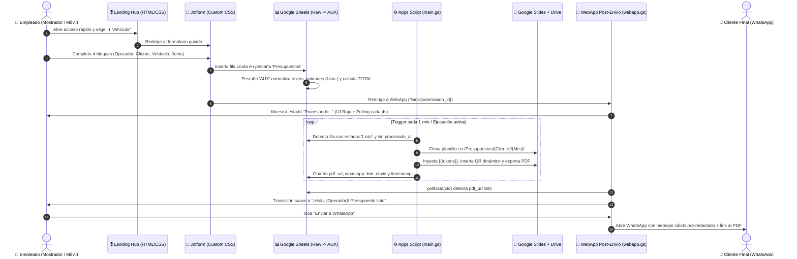

<div align="right">
  🌐 <strong>Idioma / Language:</strong> <a href="./01-service-blueprint.md">🇺🇸 Read in English</a> | 🇦🇷 <strong>Español</strong>
</div>

# 🏗️ 01. Service Blueprint — Frontstage vs. Backstage

Este documento mapea la arquitectura completa del servicio diseñado para **Lubricantes Sur**, mostrando cómo una experiencia aparentemente simple de **3 pasos en menos de 1 minuto** para el empleado de mostrador es sostenida por un ecosistema automatizado sin fricción ni costo de licencias.

---

## 🔄 Diagrama de Secuencia End-to-End (Flujo Técnico y de Usuario)



---

## 🗺️ Mapeo de Capas del Servicio (Service Blueprint)

| Etapa del Flujo | 1. Inicio y Segmentación | 2. Captura de Datos | 3. Procesamiento y Cálculo | 4. Composición Documental | 5. Entrega y Cierre (Último Eslabón) |
| :--- | :--- | :--- | :--- | :--- | :--- |
| **👤 Acción del Empleado (Frontstage Interno)** | Abre el acceso directo en el móvil o PC del mostrador y selecciona `1 Vehículo` o `+ de 1 Vehículo`. | Selecciona su nombre (`Atendido por`), ingresa datos del cliente, vehículo y carga solo `Cantidad`, `Descripción` e `Importe unitario`. | Espera entre 15 y 45 segundos en la pantalla de transición tras presionar **Enviar**. | *(Transparente para el empleado — ocurre 100% en segundo plano).* | Toca **Abrir Presupuesto** para verificarlo o **Enviar a WhatsApp** para mandarlo al cliente en 1 clic. |
| **🖥️ Interfaz Visual (Touchpoint UI)** | [`src/landing/index.html`](../src/landing/index.html) (Glassmorphism sobre gradiente amarillo `#FFD500`). | Jotform estilizado con [`src/styles/jotform-custom.css`](../src/styles/jotform-custom.css). | [`src/postenvio.html`](../src/postenvio.html) en estado `.procesando` (tarjeta roja con feedback visual). | Plantilla A4 en Google Slides (diseñada en Adobe InDesign). | [`src/postenvio.html`](../src/postenvio.html) en estado `.listo` con saludo personalizado (`¡Hola, Luci!`). |
| **⚙️ Lógica de Backstage (Sheets + Apps Script)** | Enrutamiento estático sin latencia alojado en Netlify/GitHub Pages. | Validación de máscaras (`CUIT`, `Teléfono`), desplegable de marcas con fallback a `"Otra"` y límite de `188 caracteres` en observaciones. | La hoja `AUX` ejecuta `ARRAYFORMULA`: limpia patentes, capitaliza nombres, asigna el ID `P-YYYY-NNN` y multiplica `cant_N * unitario_N`. | `main.gs` crea las carpetas `/Presupuestos/{Cliente}/{Mes}/`, reemplaza tokens `{{...}}`, inyecta el QR, convierte a PDF y borra el temporal. | `webapp.gs` responde al polling (`pollData`), actualiza el nombre del operador (*Self-Healing UI*) y habilita el link `wa.me`. |
| **🤝 Impacto en el Cliente Final (Frontstage Externo)** | Respuesta ágil incluso cuando el local está lleno de clientes presenciales. | Datos del vehículo y diagnóstico técnico documentados sin omisiones. | Cero errores de suma o discrepancias entre los ítems listados y el total final. | Recibe un PDF formal, numerado, con validez clara de `15 días` y membrete corporativo. | Recibe un mensaje de WhatsApp cordial, personalizado con su nombre y sin errores de tipeo ni mayúsculas agresivas. |

---

## 📂 Organización Automatizada en Google Drive

Antes de este sistema, los archivos quedaban sueltos en el escritorio de la PC con nombres arbitrarios (`PRESUPUEST0 MUUNI (1).docx`). El motor [`fusionarYExportarPDF_`](../src/main.gs#L136-L178) en `main.gs` construye dinámicamente un árbol de directorios auditable:

```text
📁 Mi unidad (Google Drive)
 └── 📁 Presupuestos/
      ├── 📁 Micaela R./
      │    └── 📁 diciembre/
      │         └── 📄 Presupuesto_P-2025-252_Micaela_R.pdf
      └── 📁 Metcons/
           └── 📁 julio/
                ├── 📄 Presupuesto_P-2026-004_Metcons.pdf
                └── 📄 Presupuesto_P-2026-005_Metcons.pdf
```

* **Deduplicación inteligente (`findOrDedupByName_`):** Si un presupuesto ya existe con el mismo código y cliente dentro del mes correspondiente, el script reutiliza el archivo existente y garantiza sus permisos de visualización sin duplicar PDFs en Drive.
