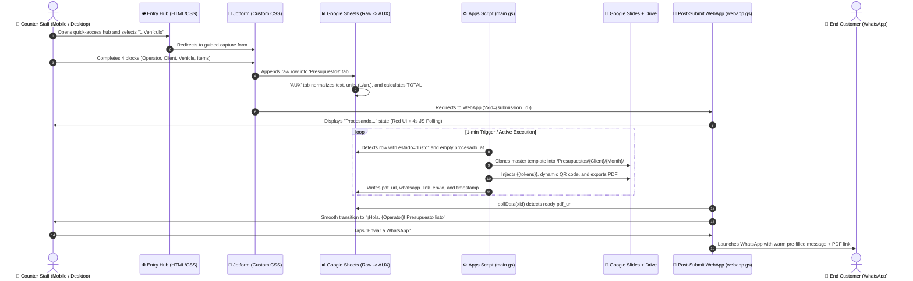

<div align="right">
  🌐 <strong>Language / Idioma:</strong> 🇺🇸 <strong>English</strong> | <a href="./01-service-blueprint.es.md">🇦🇷 Leer en Español</a>
</div>

# 🏗️ 01. Service Blueprint — Frontstage vs. Backstage

This document maps the end-to-end service architecture designed for **Lubricantes Sur**, illustrating how a frictionless **3-step, under-45-second experience** for counter staff is powered by a zero-cost automated backend.

---

## 🔄 End-to-End Sequence Diagram (User & System Flow)



---

## 🗺️ Service Blueprint Layer Mapping

| Stage | 1. Entry & Segmentation | 2. Guided Data Capture | 3. Processing & Math | 4. Document Composition | 5. Last-Mile Delivery |
| :--- | :--- | :--- | :--- | :--- | :--- |
| **👤 Staff Action (Internal Frontstage)** | Opens shortcut on phone or counter PC and selects `1 Vehículo` or `+ de 1 Vehículo`. | Selects operator name (`Atendido por`), enters client/vehicle details, and inputs only `Quantity`, `Description`, and `Unit Price`. | Waits 15–45 seconds on the transition screen after tapping **Submit**. | *(100% transparent to the employee — happens entirely in the background).* | Taps **Abrir Presupuesto** to preview or **Enviar a WhatsApp** to send in 1 click. |
| **🖥️ Visual Touchpoint (UI)** | [`src/landing/index.html`](../src/landing/index.html) (Glassmorphism over `#FFD500` gradient). | Jotform styled via [`src/styles/jotform-custom.css`](../src/styles/jotform-custom.css). | [`src/postenvio.html`](../src/postenvio.html) in `.procesando` state (red high-contrast card). | A4 Master Template in Google Slides (originally designed in Adobe InDesign). | [`src/postenvio.html`](../src/postenvio.html) in `.listo` state with personalized greeting (`¡Hola, Luci!`). |
| **⚙️ Backstage Logic (Sheets + Apps Script)** | Zero-latency static routing hosted on Netlify / GitHub Pages. | Input masks (`CUIT`, `Phone`), car brand dropdown with `"Other"` escape, and `188-char` cap on notes. | `AUX` tab runs `ARRAYFORMULA`: sanitizes plates, capitalizes names, assigns `P-YYYY-NNN` ID, and multiplies `cant_N * unitario_N`. | `main.gs` creates `/Presupuestos/{Client}/{Month}/` folders, replaces `{{tokens}}`, injects QR, exports PDF, and trashes temp file. | `webapp.gs` answers `pollData`, dynamically updates the operator's name (*Self-Healing UI*), and enables the `wa.me` deep link. |
| **🤝 Customer Impact (External Frontstage)** | Fast response even during peak walk-in hours. | Vehicle details and technical diagnostics documented without omissions. | Zero addition errors or discrepancies between line items and total price. | Receives a formal, numbered PDF quote with a clear `15-day` validity period. | Receives a polite, personalized WhatsApp message free of typos or aggressive ALL-CAPS formatting. |

---

## 📂 Automated Google Drive Taxonomy

Before this system, files were dumped onto the desktop with arbitrary names (`PRESUPUEST0 MUUNI (1).docx`). The [`fusionarYExportarPDF_`](../src/main.gs#L136-L178) function in `main.gs` dynamically builds an auditable directory tree:

```text
📁 My Drive (Google Drive)
 └── 📁 Presupuestos/
      ├── 📁 Micaela R./
      │    └── 📁 diciembre/
      │         └── 📄 Presupuesto_P-2025-252_Micaela_R.pdf
      └── 📁 Metcons/
           └── 📁 julio/
                ├── 📄 Presupuesto_P-2026-004_Metcons.pdf
                └── 📄 Presupuesto_P-2026-005_Metcons.pdf
```

* **Idempotent Deduplication (`findOrDedupByName_`):** If a quote with the exact same ID and client name already exists inside that month's folder, the script reuses the existing file and ensures public view permissions without creating duplicate PDFs.
