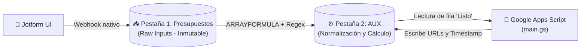
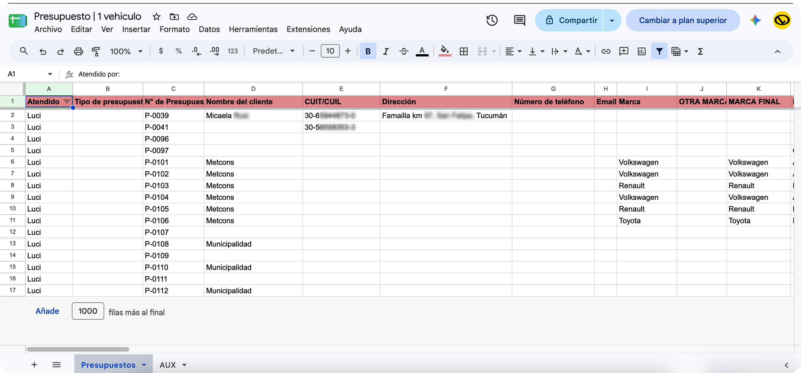
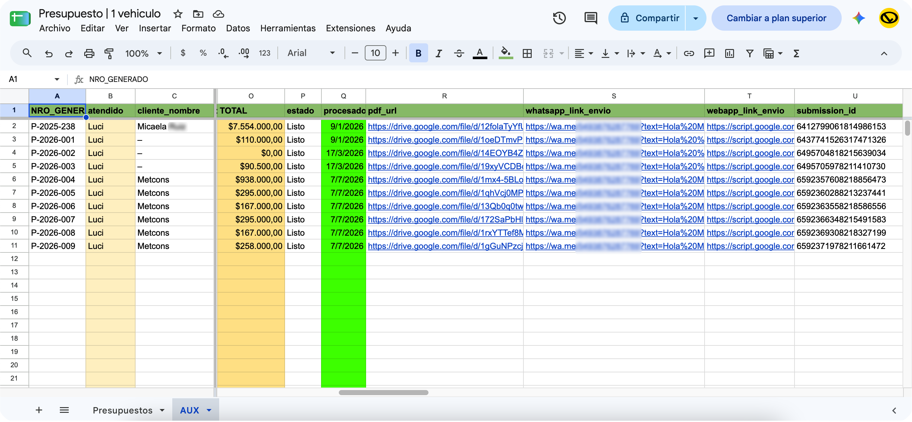

<div align="right">
  🌐 <strong>Idioma / Language:</strong> <a href="./sheets-schema.md">🇺🇸 Read in English</a> | 🇦🇷 <strong>Español</strong>
</div>

# 📊 Arquitectura de Datos en Google Sheets (Two-Layer Schema)

El motor de datos en Google Sheets fue diseñado bajo un patrón de **aislamiento entre captura y procesamiento** para evitar que la integración nativa de Jotform (que inserta filas nuevas y sobreescribe formatos) rompa las fórmulas de negocio o sea alterada accidentalmente por los empleados.

---

## 🏗️ Estructura de Dos Capas



### 1. Capa Cruda: Pestaña `Presupuestos` (Hoja A)
Recibe el volcado directo de Jotform sin intervención humana. Contiene 62 columnas brutas, incluyendo columnas auxiliares creadas por la lógica condicional del formulario (por ejemplo, `Marca`, `OTRA MARCA` y `MARCA FINAL`).



### 2. Capa de Normalización y Estado: Pestaña `AUX` (Hoja B)
Es la **única fuente de verdad (*Single Source of Truth*)** que consume tanto el motor generador de PDFs (`main.gs`) como la WebApp post-envío (`webapp.gs`). Transforma los datos crudos en tiempo real mediante fórmulas matriciales (`ARRAYFORMULA`, `INDEX/MATCH`, `REGEXEXTRACT`, `REGEXREPLACE`).



---

## 🧬 Diccionario de Columnas y Fórmulas Clave en `AUX`

### A. Identificación, Trazabilidad y Gobernanza

| Columna (`AUX`) | Origen (`Presupuestos`) | Regla de Normalización / Fórmula Real | Propósito de UX / Negocio |
| :--- | :--- | :--- | :--- |
| **`NRO_GENERADO`** | `Fecha del presupuesto` + Índice de fila | `"P-" & TEXT(VALUE(D2:D),"yyyy") & "-" & TEXT(COUNTIFS(...), "000")` | Genera numeración correlativa anual automática (`P-2025-252`, `P-2026-001`), eliminando archivos sin nombre o duplicados. |
| **`atendido`** | `Atendido por:` | `INDEX(Presupuestos!..., MATCH("*Atendido*", ...))` | **Accountability interno:** permite saber qué vendedor emitió cada presupuesto y personalizar el saludo en la WebApp (`¡Hola, Luci!`). |
| **`cliente_nombre`** | `Nombre del cliente` | `PROPER(LOWER(TRIM(...)))` | Corrige ingresos escritos íntegramente en `MAYÚSCULAS` o `minúsculas` a formato `Nombre Propio`, o asigna `–` si está vacío. |
| **`fecha`** | `Fecha del presupuesto` | `ARRAYFORMULA(TO_DATE(VALUE(...)))` | Garantiza fecha cierta de emisión para proteger al negocio frente a la inflación. |
| **`validez_dias`** | `Validez` | Valor por defecto: `15 días` (editable) | Acota la vigencia comercial del presupuesto sin requerir tipeo manual. |

### B. Normalización de Vehículo y Cliente (Poka-Yoke de Datos)

| Columna (`AUX`) | Origen (`Presupuestos`) | Regla de Normalización / Fórmula Real | Propósito de UX / Negocio |
| :--- | :--- | :--- | :--- |
| **`vehiculo_marca`** | `Marca` / `OTRA MARCA` / `MARCA FINAL` | Evalúa si se eligió una marca del desplegable rápido o `"Otra (especificar)"` y consolida un único valor limpio (`MARCA FINAL`). | En el formulario el empleado ve un desplegable ágil; en la base de datos las 3 columnas condicionales se unifican en 1 sola. |
| **`vehiculo_modelo`** | `Modelo` + `Año` | `Modelo & IF(LEN(Año), " (" & Año & ")", "")` | Concatena modelo y año en un solo token limpio (ej. `Cronos (2022)`) para optimizar el espacio en la tabla del PDF. |
| **`vehiculo_patente`** | `Patente` | `UPPER(SUBSTITUTE(SUBSTITUTE(TRIM(...)," ",""),"-",""))` | Elimina guiones, espacios intermedios y pasa a mayúsculas (`ab 773 kz` → `AB773KZ`). |
| **`vehiculo_km`** | `Km actuales` | `REGEXREPLACE(TO_TEXT(...), ",00$", "") & " km"` | Limpia decimales residuales y añade el sufijo `km` (o `–` si no aplica). |

### C. Motor de Precios y Reconocimiento de Unidades (Granel vs. Envasado)

En un lubricentro conviven productos vendidos **por unidad cerrada** (filtros, aditivos, tambores) y **lubricantes a granel vendidos por litro**. En lugar de obligar al empleado a usar dos tablas distintas o calcular con calculadora:

1. **Extracción y Normalización de Cantidad (`cant_1` a `cant_12`):**
   ```excel
   =ARRAYFORMULA(
     IF(LEN(Presupuestos!V2:V)=0, "",
       SUBSTITUTE(REGEXEXTRACT(TO_TEXT(Presupuestos!V2:V), "(\d+(?:[.,]\d+)?)"), ".", ",")
       & IFERROR(" " & REGEXEXTRACT(TO_TEXT(Presupuestos!V2:V), "\d+(?:[.,]\d+)?\s*([A-Za-zÁÉÍÓÚÜÑáéíóúüñ]+)"), "")
     )
   )
   ```
   *(Posteriormente, `enrichMap_` en `main.gs` estandariza cualquier variante como `4 lts`, `4 litros`, `4 litos` a **`4 L`**, y los números puros como `10` a **`10 un.`**).*

2. **Cálculo Automático de Subtotal por Ítem (`importe_1` a `importe_12`):**
   El empleado solo carga en Jotform la `Cantidad` y el precio unitario (`unitario_N`). La hoja `AUX` extrae el valor numérico puro de ambos campos mediante expresiones regulares y calcula el subtotal automáticamente:
   ```excel
   =ARRAYFORMULA(
     VALUE(REGEXREPLACE(TO_TEXT(unitario_1), "[^\d,]", "")) *
     IFERROR(VALUE(REGEXEXTRACT(TO_TEXT(cant_1), "(\d+(?:[.,]\d+)?)")), 1)
   )
   ```

3. **Suma Total Inmutable (`TOTAL`):**
   Suma verticalmente `importe_1` hasta `importe_12` (`N(IFERROR(importe_1, 0)) + ...`), erradicando el error humano de suma manual que ocurría en los antiguos documentos de Word.

### D. Columnas de Estado y Handoff (Escritas por `main.gs`)

| Columna (`AUX`) | Generado por | Descripción |
| :--- | :--- | :--- |
| **`estado`** | Fórmula (`IF(LEN(C2:C), "Listo", "")`) | Indica al trigger de Apps Script que la fila ya tiene los datos mínimos calculados para generar el PDF. |
| **`procesado_at`** | `main.gs` (`timestamp`) | Fecha y hora exacta en que se generó el PDF. Evita reprocesar filas ya emitidas (idempotencia). |
| **`pdf_url`** | `main.gs` | URL pública de Google Drive del PDF generado y archivado en `/Presupuestos/{Cliente}/{Mes}/`. |
| **`whatsapp_link_envio`** | `main.gs` | Deep-link `https://wa.me/549...` con teléfono normalizado y mensaje personalizado pre-armado. |
| **`webapp_link_envio`** | `main.gs` | URL de la WebApp post-envío vinculada al `submission_id` (`?xid=...`). |
| **`submission_id`** | Jotform → `AUX` | Clave primaria de rastreo (`xid`) que conecta la redirección de Jotform con el polling en tiempo real de `webapp.gs`. |
