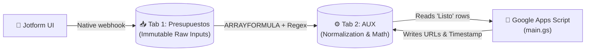
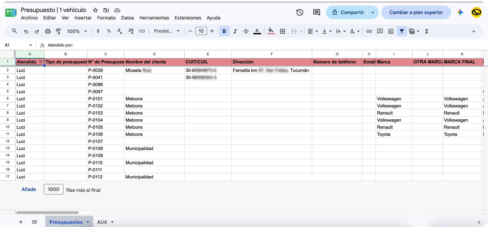
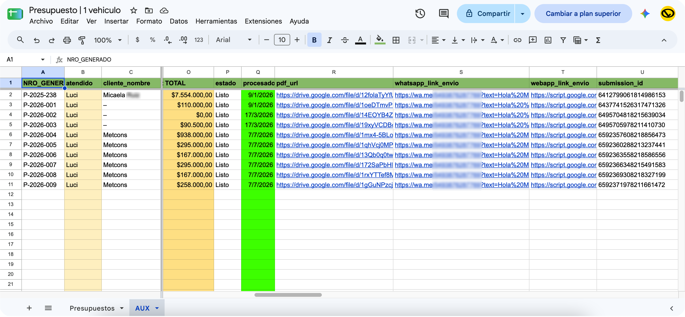

<div align="right">
  🌐 <strong>Language / Idioma:</strong> 🇺🇸 <strong>English</strong> | <a href="./sheets-schema.es.md">🇦🇷 Leer en Español</a>
</div>

# 📊 Google Sheets Data Architecture (Two-Layer Schema)

The Google Sheets backend was engineered using a **strict separation between raw capture and data normalization** so that Jotform's native webhook (which appends new rows and resets cell formatting) never breaks business formulas or gets accidentally overwritten by counter staff.

---

## 🏗️ Two-Layer Architecture



### 1. Raw Layer: `Presupuestos` Tab (Sheet A)
Receives raw form submissions directly from Jotform without human intervention. Contains 62 raw columns, including auxiliary columns created by conditional form logic (e.g., `Marca`, `OTRA MARCA`, and `MARCA FINAL`).



### 2. Normalization & State Layer: `AUX` Tab (Sheet B)
Acts as the **Single Source of Truth** consumed by both the PDF generator (`main.gs`) and the post-submit WebApp (`webapp.gs`). It transforms raw inputs in real time via array formulas (`ARRAYFORMULA`, `INDEX/MATCH`, `REGEXEXTRACT`, `REGEXREPLACE`).



---

## 🧬 Column Dictionary & Core Formulas in `AUX`

### A. Attribution, Traceability & Governance

| Column (`AUX`) | Source (`Presupuestos`) | Normalization Rule / Production Formula | UX / Business Purpose |
| :--- | :--- | :--- | :--- |
| **`NRO_GENERADO`** | `Fecha del presupuesto` + Row Index | `"P-" & TEXT(VALUE(D2:D),"yyyy") & "-" & TEXT(COUNTIFS(...), "000")` | Generates an automatic annual sequential ID (`P-2025-252`, `P-2026-001`), eliminating unnamed or duplicate files. |
| **`atendido`** | `Atendido por:` | `INDEX(Presupuestos!..., MATCH("*Atendido*", ...))` | **Internal accountability:** tracks which employee issued each quote and personalizes the WebApp greeting (`¡Hola, Luci!`). |
| **`cliente_nombre`** | `Nombre del cliente` | `PROPER(LOWER(TRIM(...)))` | Converts `ALL CAPS` or `lowercase` entries into `Title Case`, or defaults to `–` if left blank. |
| **`fecha`** | `Fecha del presupuesto` | `ARRAYFORMULA(TO_DATE(VALUE(...)))` | Guarantees an explicit issue date to protect margins against inflation. |
| **`validez_dias`** | `Validez` | Default value: `15 días` (editable) | Sets a clear commercial expiration window without requiring manual typing. |

### B. Vehicle & Customer Normalization (Data Poka-Yoke)

| Column (`AUX`) | Source (`Presupuestos`) | Normalization Rule / Production Formula | UX / Business Purpose |
| :--- | :--- | :--- | :--- |
| **`vehiculo_marca`** | `Marca` / `OTRA MARCA` / `MARCA FINAL` | Evaluates whether a standard dropdown brand or `"Otra (especificar)"` was selected and consolidates a single clean string (`MARCA FINAL`). | Counter staff see a fast dropdown; the database silently merges 3 conditional columns into 1 attribute. |
| **`vehiculo_modelo`** | `Modelo` + `Año` | `Modelo & IF(LEN(Año), " (" & Año & ")", "")` | Concatenates model and year into a single token (e.g., `Cronos (2022)`) to save horizontal space in the PDF table. |
| **`vehiculo_patente`** | `Patente` | `UPPER(SUBSTITUTE(SUBSTITUTE(TRIM(...)," ",""),"-",""))` | Strips hyphens and spaces and forces uppercase (`ab 773 kz` → `AB773KZ`). |
| **`vehiculo_km`** | `Km actuales` | `REGEXREPLACE(TO_TEXT(...), ",00$", "") & " km"` | Strips trailing decimals and appends `km` (or `–` if empty). |

### C. Pricing Engine & Smart Unit Recognition (Bulk vs. Packaged)

In an automotive service center, sealed products sold **by the unit** (filters, additives, drums) coexist with **bulk lubricants sold by the liter**. Instead of forcing staff to use two separate tables or a calculator:

1. **Quantity Extraction & Normalization (`cant_1` to `cant_12`):**
   ```excel
   =ARRAYFORMULA(
     IF(LEN(Presupuestos!V2:V)=0, "",
       SUBSTITUTE(REGEXEXTRACT(TO_TEXT(Presupuestos!V2:V), "(\d+(?:[.,]\d+)?)"), ".", ",")
       & IFERROR(" " & REGEXEXTRACT(TO_TEXT(Presupuestos!V2:V), "\d+(?:[.,]\d+)?\s*([A-Za-zÁÉÍÓÚÜÑáéíóúüñ]+)"), "")
     )
   )
   ```
   *(Subsequently, `enrichMap_` in `main.gs` standardizes any volume variant like `4 lts`, `4 litros`, or the typo `4 litos` into **`4 L`**, and plain numbers like `10` into **`10 un.`**).*

2. **Automatic Line-Item Subtotal (`importe_1` to `importe_12`):**
   Staff only enter `Quantity` and `Unit Price` (`unitario_N`) in Jotform. The `AUX` sheet extracts the raw numeric value from both fields via Regex and multiplies them automatically:
   ```excel
   =ARRAYFORMULA(
     VALUE(REGEXREPLACE(TO_TEXT(unitario_1), "[^\d,]", "")) *
     IFERROR(VALUE(REGEXEXTRACT(TO_TEXT(cant_1), "(\d+(?:[.,]\d+)?)")), 1)
   )
   ```

3. **Immutable Grand Total (`TOTAL`):**
   Sums `importe_1` through `importe_12` (`N(IFERROR(importe_1, 0)) + ...`), completely eradicating the manual addition errors that plagued legacy Word files.

### D. State & Handoff Columns (Written by `main.gs`)

| Column (`AUX`) | Populated By | Description |
| :--- | :--- | :--- |
| **`estado`** | Formula (`IF(LEN(C2:C), "Listo", "")`) | Signals to the Apps Script trigger that the row has completed calculation and is ready for PDF generation. |
| **`procesado_at`** | `main.gs` (`timestamp`) | Exact timestamp when the PDF was generated. Prevents duplicate processing (idempotency). |
| **`pdf_url`** | `main.gs` | Public Google Drive URL of the generated PDF archived under `/Presupuestos/{Client}/{Month}/`. |
| **`whatsapp_link_envio`** | `main.gs` | `https://wa.me/549...` deep link with normalized phone number and pre-filled customer message. |
| **`webapp_link_envio`** | `main.gs` | Post-submit WebApp URL tied to the `submission_id` (`?xid=...`). |
| **`submission_id`** | Jotform → `AUX` | Primary lookup key (`xid`) linking the Jotform redirect to real-time polling in `webapp.gs`. |
