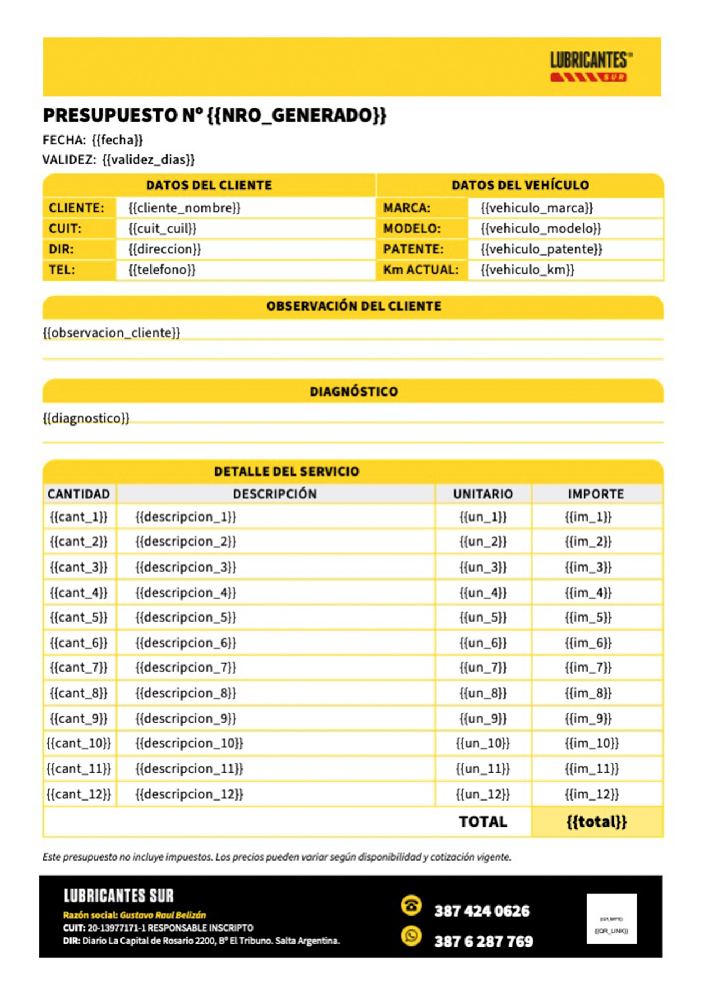
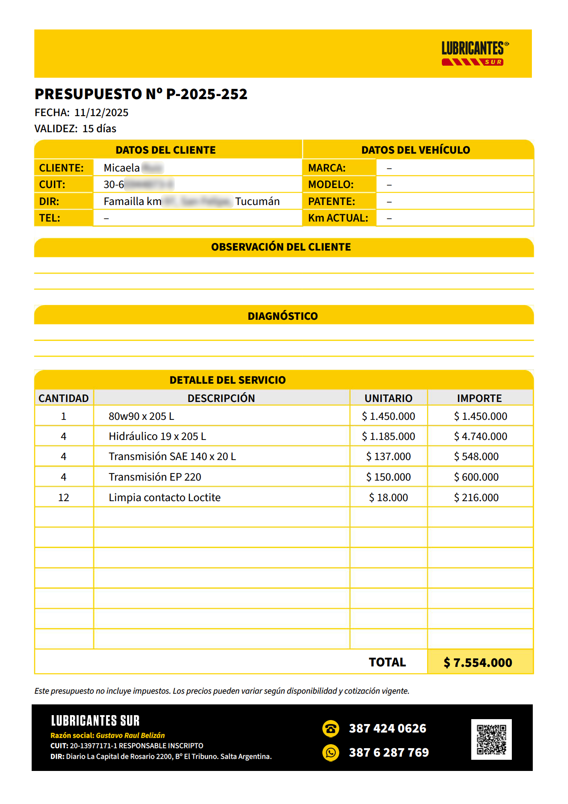

  🌐 <strong>Idioma / Language:</strong> <a href="./slides-tokens-reference.md">🇺🇸 Read in English</a> | 🇦🇷 <strong>Español</strong>

# 🎨 Sistema de Tokens y Plantilla Maestra (Adobe InDesign → Google Slides)

Para lograr que el documento final tuviera **calidad editorial de imprenta** pero pudiera ser inyectado dinámicamente a costo `$0` desde Google Apps Script, el diseño se ejecutó en dos etapas:

1. **Arquitectura Editorial en Adobe InDesign:** Se diseñó la grilla tipográfica, las proporciones de columnas, las jerarquías de lectura rápida y el bloque institucional inferior en InDesign (herramienta estándar para maquetación de tablas complejas y datos tabulares).
2. **Portabilidad y Tokenización en Google Slides:** Se replicó el layout exacto en una diapositiva maestra vertical A4 dentro de Google Slides, reemplazando cada celda dinámica por **Content Tokens** (`{{token}}`).

---

## 🖼️ Comparativa Visual: Plantilla de Tokens vs. PDF Renderizado

| Plantilla Maestra en Google Slides (`{{tokens}}`) | Entregable Final Normalizado (PDF Exportado) |
| :---: | :---: |
|  |  |

---

## 🔑 Diccionario de Variables Dinámicas (Tokens)

El motor [`src/main.gs`](../src/main.gs) ejecuta un reemplazo dual (`{{variable}}` y `<<variable>>` por retrocompatibilidad con prototipos previos en AutoCrat/Document Studio).

### 1. Encabezado y Vigencia Comercial

| Token en Google Slides | Fuente en `AUX` | Formato Renderizado | Regla de Negocio / UX |
| :--- | :--- | :--- | :--- |
| `{{NRO_GENERADO}}` | `NRO_GENERADO` | `P-2025-252` | Identificador único para trazabilidad administrativa y reclamos. |
| `{{fecha}}` | `fecha` | `11/12/2025` | Formateado por `Utilities.formatDate(..., 'dd/MM/yyyy')`. |
| `{{validez_dias}}` | `validez_dias` | `15 días` | Protege al negocio ante variaciones inflacionarias de precios. |

### 2. Bloque Dual: Datos del Cliente y Datos del Vehículo

| Token en Google Slides | Fuente en `AUX` | Ejemplo Renderizado | Comportamiento ante Vacío (Fallback) |
| :--- | :--- | :--- | :--- |
| `{{cliente_nombre}}` | `cliente_nombre` | `Micaela R.` | `–` (Guion medio limpio, nunca deja tokens crudos visibles) |
| `{{cuit_cuil}}` | `cuit_cuil` | `30-XXXXXXXX-0` | `–` (Forzado a `String` para evitar notación científica) |
| `{{direccion}}` | `direccion` | `Famaillá, Tucumán` | `–` |
| `{{telefono}}` | `telefono` | `387 500 0000` | `–` |
| `{{vehiculo_marca}}` | `vehiculo_marca` | `Volkswagen` | `–` (Unifica desplegable + opción `"Otra"`) |
| `{{vehiculo_modelo}}` | `vehiculo_modelo` | `Saveiro (2021)` | `–` (Combina modelo y año automáticamente) |
| `{{vehiculo_patente}}` | `vehiculo_patente` | `AB773KZ` | `–` (Sanitizado en mayúsculas sin guiones) |
| `{{vehiculo_km}}` | `vehiculo_km` | `117.000 km` | `–` |

### 3. Bloques de Diagnóstico y Contexto Técnico

| Token en Google Slides | Fuente en `AUX` | Restricción de UX en Jotform | Propósito |
| :--- | :--- | :--- | :--- |
| `{{observacion_cliente}}` | `observacion_cliente` | Máx. `188 caracteres` | Documenta el pedido o síntoma reportado por el cliente sin desbordar las líneas de la plantilla. |
| `{{diagnostico}}` | `diagnostico` | Máx. `188 caracteres` | Deja constancia escrita de las recomendaciones técnicas del lubricentro (ej. *"se recomienda cambio de filtro de nafta"*). |
| *(Omitido en PDF)* | `Comentario interno` | Solo visible en Sheets | Permite que el empleado deje notas internas para administración sin que salgan impresas en el PDF del cliente. |

### 4. Grilla Modular de Ítems (Filas `1` a `12`)

Para evitar que los nombres de variables largos (`{{unitario_10}}`) desborden el ancho fijo de las celdas en la vista de edición de Google Slides, la función `createAliases_(map)` en [`src/main.gs`](../src/main.gs) genera alias cortos (`{{un_N}}` e `{{im_N}}`):

| Columna en Tabla | Token (`N = 1..12`) | Ejemplo Renderizado | Lógica Aplicada (`enrichMap_`) |
| :--- | :--- | :--- | :--- |
| **CANTIDAD** | `{{cant_1}}` .. `{{cant_12}}` | `10 un.` o `4 L` | Detecta sufijos de volumen (`l`, `lt`, `lts`, `litros`, `litos`) y normaliza a `L`; si es número entero/decimal, añade `un.`. |
| **DESCRIPCIÓN** | `{{descripcion_1}}` .. `{{descripcion_12}}` | `Aceite de motor 10W-40 x L` | Texto limpio; si la fila no fue utilizada, se inyecta cadena vacía `""`. |
| **UNITARIO** | `{{un_1}}` .. `{{un_12}}` | `$ 11.000` | Formateado por `formatMoneyNoRound_` con separador de miles `.` y signo `$`. |
| **IMPORTE** | `{{im_1}}` .. `{{im_12}}` | `$ 110.000` | Resultado del cálculo automático `Cantidad × Unitario` en la hoja `AUX`. |
| **TOTAL** | `{{total}}` / `{{TOTAL}}` | **`$ 7.554.000`** | Suma total destacada en el pie de tabla. |

### 5. Pie Institucional y Token de Imagen Dinámica (`{{QR_MAPS}}`)

En el zócalo negro del documento se incluye un shape con el texto `{{QR_MAPS}}`. Durante la ejecución de `fusionarYExportarPDF_`, la función `insertQr_`:
1. Localiza las coordenadas exactas (`left`, `top`, `width`, `height`) del shape `{{QR_MAPS}}`.
2. Genera un código QR de alta resolución (`ecc=H`) apuntando a la ubicación / landing del lubricentro (`qr_maps_url`).
3. Inserta la imagen vectorial/PNG en esa posición exacta, le asigna el hipervínculo clickeable y elimina el shape contenedor.
