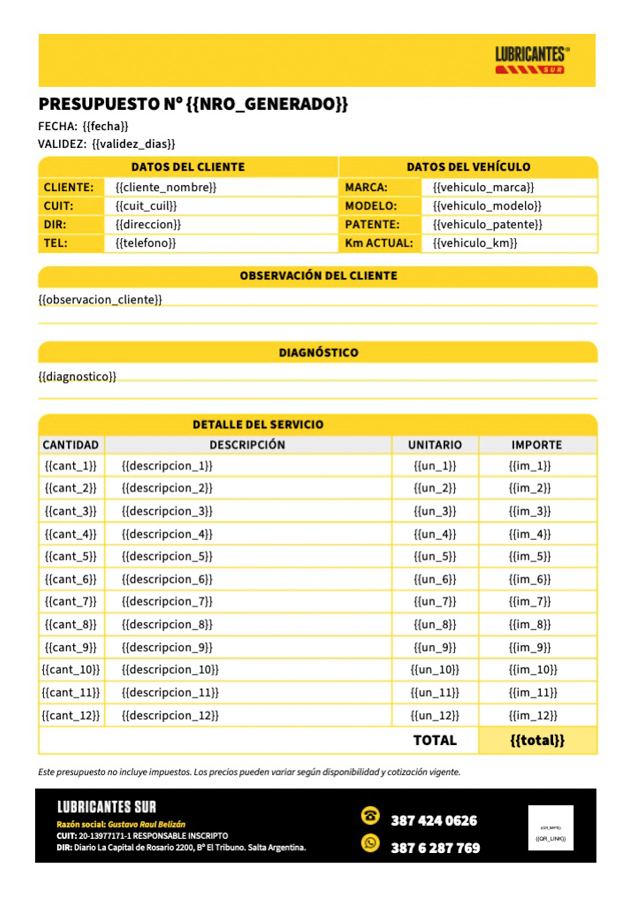
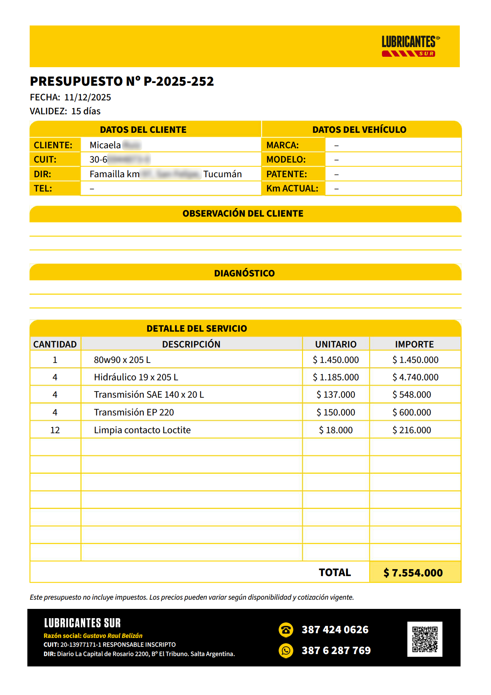

  🌐 <strong>Language / Idioma:</strong> 🇺🇸 <strong>English</strong> | <a href="./slides-tokens-reference.es.md">🇦🇷 Leer en Español</a>

# 🎨 Design Tokens & Master Template System (Adobe InDesign → Google Slides)

To achieve **print-grade editorial quality** while injecting dynamic data at `$0` infrastructure cost via Google Apps Script, the document system was built in two stages:

1. **Editorial Grid in Adobe InDesign:** Typographic hierarchy, column proportions, scannable pricing tables, and the corporate footer were first crafted in InDesign (the industry standard for complex tabular layouts).
2. **Portability & Tokenization in Google Slides:** The exact layout was replicated onto a vertical A4 master slide in Google Slides, replacing every dynamic cell with **Content Tokens** (`{{token}}`).

---

## 🖼️ Visual Comparison: Tokenized Master vs. Rendered PDF

| Tokenized Master Template in Google Slides (`{{tokens}}`) | Final Normalized Deliverable (Exported PDF) |
| :---: | :---: |
|  |  |

---

## 🔑 Dynamic Variable Dictionary (Tokens)

The [`src/main.gs`](../src/main.gs) engine runs a dual replacement pass (`{{variable}}` and `<<variable>>` for backward compatibility with early AutoCrat/Document Studio prototypes).

### 1. Header & Commercial Validity

| Google Slides Token | `AUX` Source | Rendered Format | Business / UX Rule |
| :--- | :--- | :--- | :--- |
| `{{NRO_GENERADO}}` | `NRO_GENERADO` | `P-2025-252` | Unique identifier for administrative tracking and customer lookup. |
| `{{fecha}}` | `fecha` | `11/12/2025` | Formatted via `Utilities.formatDate(..., 'dd/MM/yyyy')`. |
| `{{validez_dias}}` | `validez_dias` | `15 días` | Protects business margins against inflationary price shifts. |

### 2. Dual Block: Customer & Vehicle Data

| Google Slides Token | `AUX` Source | Rendered Example | Empty-State Fallback |
| :--- | :--- | :--- | :--- |
| `{{cliente_nombre}}` | `cliente_nombre` | `Micaela R.` | `–` (Clean en-dash; never leaves raw unparsed tokens visible) |
| `{{cuit_cuil}}` | `cuit_cuil` | `30-XXXXXXXX-0` | `–` (Forced to `String` to prevent scientific notation) |
| `{{direccion}}` | `direccion` | `Famaillá, Tucumán` | `–` |
| `{{telefono}}` | `telefono` | `387 500 0000` | `–` |
| `{{vehiculo_marca}}` | `vehiculo_marca` | `Volkswagen` | `–` (Unifies quick dropdown + `"Other"` conditional field) |
| `{{vehiculo_modelo}}` | `vehiculo_modelo` | `Saveiro (2021)` | `–` (Automatically concatenates model and year) |
| `{{vehiculo_patente}}` | `vehiculo_patente` | `AB773KZ` | `–` (Sanitized uppercase without hyphens or spaces) |
| `{{vehiculo_km}}` | `vehiculo_km` | `117.000 km` | `–` |

### 3. Diagnostic & Technical Context Blocks

| Google Slides Token | `AUX` Source | UX Constraint in Jotform | Purpose |
| :--- | :--- | :--- | :--- |
| `{{observacion_cliente}}` | `observacion_cliente` | Max `188 characters` | Documents customer-reported symptoms or requests without overflowing the fixed template lines. |
| `{{diagnostico}}` | `diagnostico` | Max `188 characters` | Records written technical recommendations from the shop (e.g., *"fuel filter replacement recommended"*). |
| *(Omitted from PDF)* | `Comentario interno` | Visible only in Sheets | Allows staff to leave internal administrative notes without printing them on the customer-facing PDF. |

### 4. Modular Line-Item Grid (Rows `1` to `12`)

To prevent long variable names (`{{unitario_10}}`) from wrapping or breaking narrow table columns inside the Google Slides editor, `createAliases_(map)` in [`src/main.gs`](../src/main.gs) generates short aliases (`{{un_N}}` and `{{im_N}}`):

| Table Column | Token (`N = 1..12`) | Rendered Example | Applied Logic (`enrichMap_`) |
| :--- | :--- | :--- | :--- |
| **CANTIDAD** | `{{cant_1}}` .. `{{cant_12}}` | `10 un.` or `4 L` | Detects volume suffixes (`l`, `lt`, `lts`, `litros`, `litos`) and normalizes to `L`; if numeric, appends `un.`. |
| **DESCRIPCIÓN** | `{{descripcion_1}}` .. `{{descripcion_12}}` | `Aceite de motor 10W-40 x L` | Clean string; unused rows are injected with `""`. |
| **UNITARIO** | `{{un_1}}` .. `{{un_12}}` | `$ 11.000` | Formatted by `formatMoneyNoRound_` with `.` thousands separator and `$` prefix. |
| **IMPORTE** | `{{im_1}}` .. `{{im_12}}` | `$ 110.000` | Result of automatic `Quantity × Unit Price` calculation in `AUX`. |
| **TOTAL** | `{{total}}` / `{{TOTAL}}` | **`$ 7.554.000`** | Highlighted grand total at the bottom of the grid. |

### 5. Corporate Footer & Dynamic Image Token (`{{QR_MAPS}}`)

In the black footer bar, a square shape contains the text `{{QR_MAPS}}`. During `fusionarYExportarPDF_` execution, `insertQr_`:
1. Reads the exact bounding-box coordinates (`left`, `top`, `width`, `height`) of the `{{QR_MAPS}}` shape.
2. Generates a high-resolution QR code (`ecc=H`) pointing to the shop's location URL (`qr_maps_url`).
3. Places the PNG image at those exact coordinates, attaches the clickable hyperlink, and removes the placeholder shape.
